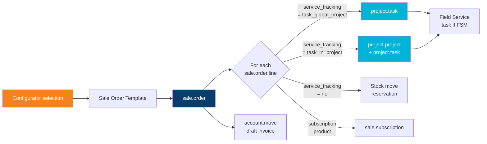
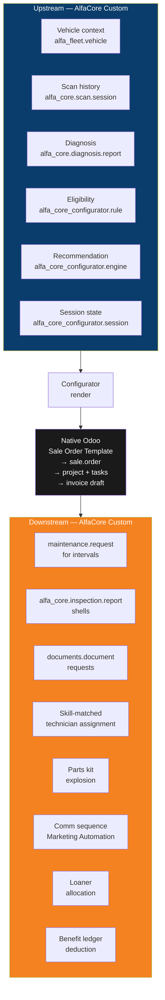
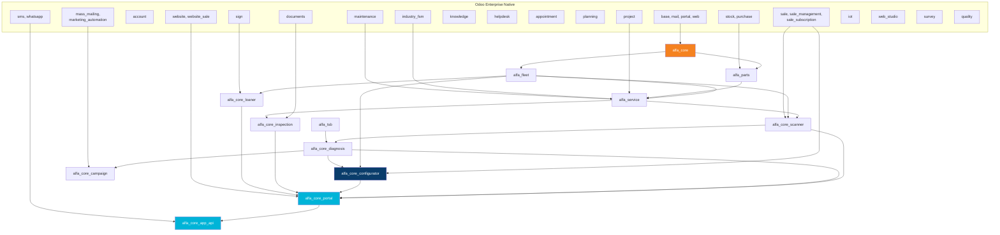
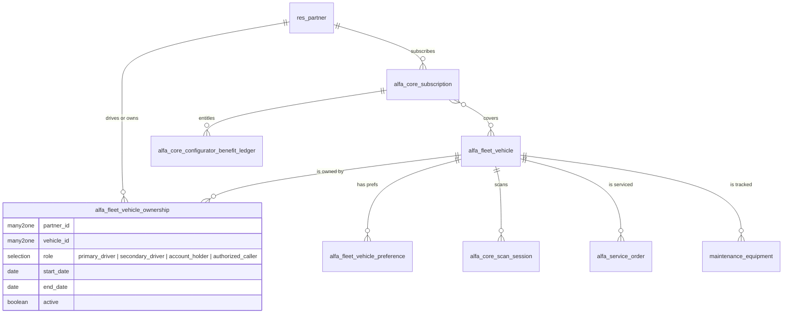
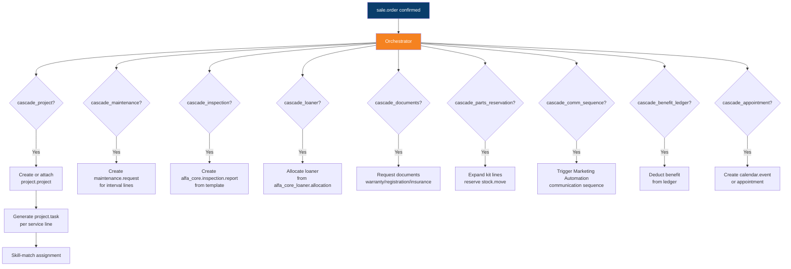
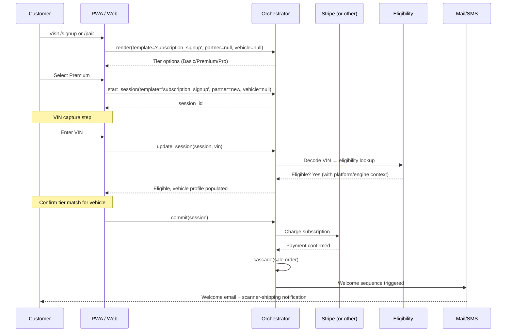
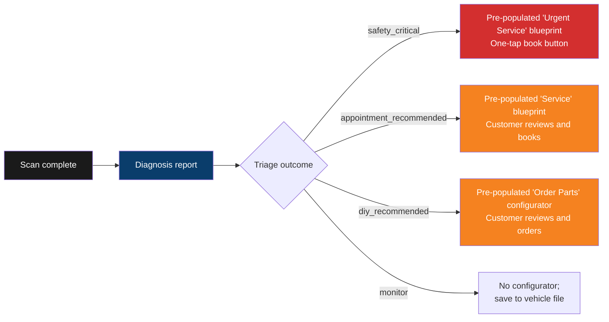
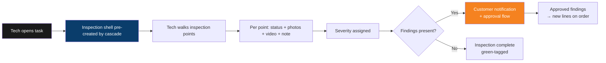

# AlfaCore — Application Architecture Blueprint v1.0

**The Luxury Automotive Service Platform — built on Odoo 19 Enterprise, configurator-centric, customer-and-mechanic dual-facing.**

**Document role:** Master architecture blueprint. Defines AlfaCore as a single Odoo Application unifying ~15 constituent modules around the Product Configurator as orchestration spine. Resolves how every native Odoo module named in the prior gap analyses composes into one platform.

**Companion to (and read after):**

1. `Alfa-Odoo-Server-Plan-v1.0.md` — substrate and base modules
2. `AlfaCore-Service-Plan-v1.0.md` — customer-facing service layer
3. `AlfaCore-JTBD-Gap-Analysis-v1.0.md` — full-lifecycle gap audit
4. `AlfaCore-Configurator-JTBD-Gap-Analysis-v1.0.md` — configurator-specific audit

**Audience:** Solution architect, lead Odoo engineer, technical PM. Secondary: dealership operations leadership reading for orientation.

**Posture (reaffirmed from the corpus):**

- Markdown canonical, Forgejo-versioned, audit-ready
- Twelve Patterns from ANDREW v2 Part X govern every architectural choice
- Honest boundaries (Pattern 10) — every Odoo claim sourced from v19 documentation
- Classification discipline preserved: **N** Native / **C** Configuration / **I** Integration / **X** Custom / **R** Future-phase R&D
- No frontend implementation, no DTC content, no triage rule content, no hardware engineering, no marketing execution, no payment-processor selection

**Status:** Draft v1.0.

---

## 1. Application Definition

### 1.1 What AlfaCore is, formally

**AlfaCore** is an Odoo 19 Enterprise *Application* — a single top-level app (declared via `application: True` in its primary manifest) anchoring a suite of fifteen-or-so constituent modules. Customers, technicians, advisors, and ownership interact with one cohesive product surface; engineering maintains a modular, separable, upgradable code base.

**Application name (customer-facing):** AlfaCore
**Technical application module:** `alfa_core`
**Application category:** `Services/Automotive`
**Application icon:** anchored to the Industrial Futurism design system

The "Application" framing matters operationally:

| Aspect | Module suite framing | Application framing |
|---|---|---|
| Customer mental model | "A bunch of installed apps" | "One product called AlfaCore" |
| Top-level menu | Scattered | Single anchored menu with sub-areas |
| Apps store presentation | 15 listings | One listing with 14 dependencies |
| Upgrade discipline | Per-module, fragile | Coordinated, atomic |
| Marketing surface | None | "Install AlfaCore" |
| Studio extension scope | Per-module ambiguity | Application-scoped customization |

### 1.2 Edition and platform requirements

| Requirement | Specification |
|---|---|
| Odoo Edition | **Enterprise 19** (Helpdesk, Field Service, Documents, Knowledge, Subscriptions, Sign, Marketing Automation, IoT, Planning, Studio, WhatsApp — all Enterprise-only) |
| Python | 3.11+ |
| PostgreSQL | 15+ |
| Browser support (PWA + portal) | Safari 17+, Chrome 121+, Firefox 124+, Edge 121+ |
| Mobile | iOS 17+ (Web Bluetooth caveats), Android 13+ |
| Substrate (per v1.0 Plan §0) | QNAP/Docker for pilot, cloud VM at scale |

### 1.3 Application boundary

**Inside the application boundary:**
- Customer-owned vehicle lifecycle (acquisition → service → resale)
- Service operation lifecycle (intake → execution → delivery → follow-up)
- Diagnostic ingestion and triage
- Subscription management
- Concierge orchestration
- Communication across all channels
- Knowledge and document management
- Quality and sign-off workflows

**Outside the application boundary** (relegated to integrations or excluded):
- New-vehicle sales floor
- Body shop / collision repair
- Insurance primary handling
- Stellantis warranty submission (gated by dealer status)
- Stellantis dealer-only data feeds (eAuthority, SDMS)
- Body-shop / detail / ceramic retail (v1 exclusion)
- Tire / seasonal-wheel storage (v1 exclusion)
- Multi-tenant white-label DMS-as-a-service (separate product entirely)

### 1.4 Relationship to the corpus

This blueprint is the **integration layer**. The prior four documents specified:

- **Substrate** (v1.0 Plan): where AlfaCore runs
- **Service model** (Service Plan): the customer-facing service offering
- **General gap audit**: what's missing across the customer/mechanic lifecycle
- **Configurator audit**: what's missing in the configurator surface specifically

This document specifies **how every named native Odoo module composes into one application**, with the Product Configurator as the spine.

---

## 2. The Core Architectural Insight — Configurator as Orchestrator

### 2.1 The native Odoo cascade

Native Odoo already implements a substantial orchestration cascade when a sale order is confirmed. The chain:



This cascade is the foundation. **Native Odoo gets you ~60% of what an automotive service platform needs.** The remaining 40% is what AlfaCore custom-extends.

### 2.2 What AlfaCore adds to the cascade

The cascade gets richer at both ends:

**Upstream (before sale.order):**
- VIN/vehicle context joins the configurator render call
- Eligibility filtering prunes options to what fits this car
- Recommendation engine ranks based on scan history, service history, mileage pattern
- Save-and-resume session state persists in-progress configurations
- Triage outputs from `alfa_core.diagnosis.report` pre-populate templates

**Downstream (after sale.order confirmation):**
- `maintenance.request` records for interval-driven services
- `alfa_core.inspection.report` shells for inspection-bearing work orders
- `documents.document` requests (warranty proof, registration, insurance)
- Technician assignments by skill-matching (not just round-robin)
- Parts kit explosion (one kit line → multiple component reservations)
- Customer communication sequence (Marketing Automation triggered by state transitions)
- Loaner allocation if loaner is on the order
- Subscription benefit ledger deduction if redeeming entitlement



### 2.3 The orchestration pattern (canonical form)

Every configurator-driven workflow in AlfaCore follows this contract:

```
configurator.render(template, partner, vehicle, session)
    → eligible_options[]
    → recommended_options[]
    → priced_options[]

configurator.commit(selection, partner, vehicle, session)
    → sale.order (native cascade triggered)
    → orchestrator.cascade(sale.order)
        → project.project (native)
        → project.task[] (native + skill-matched)
        → maintenance.request[] (custom)
        → alfa_core.inspection.report (custom)
        → documents.document[] requests (custom)
        → stock.move[] reservations (native, kit-expanded)
        → loaner allocation (custom)
        → comm sequence trigger (custom)
        → benefit ledger entry (custom)
```

This is the contract that the rest of this document elaborates.

---

## 3. The Application's Module Architecture

### 3.1 Module taxonomy

The application is composed of 15 modules organized by role:

| Role | Module | Purpose | Class |
|---|---|---|---|
| **Application anchor** | `alfa_core` | Top-level menu, application brand, base shared models, settings | X |
| **Vehicle master** | `alfa_fleet` | Customer-owned vehicles, VIN, platform/engine/trim, preferences | X |
| **Parts master** | `alfa_parts` | OEM SKUs, aftermarket alternatives, kits, vendor preferences | X |
| **Service execution** | `alfa_service` | Service orders, quality checks, bay allocation, work-order extensions | X |
| **Knowledge corpus** | `alfa_tsb` | TSB ingestion (Qdrant-backed RAG), recall library, service procedures | X |
| **Scanner pipeline** | `alfa_core_scanner` | OBD session ingestion, DTC/PID storage, scanner telemetry | X |
| **Diagnosis engine** | `alfa_core_diagnosis` | Triage rules, DTC library, AI-augmented recommendations | X |
| **Configurator engine** | `alfa_core_configurator` | Eligibility, recommendation, pricing orchestration, session state | X |
| **Inspection workflow** | `alfa_core_inspection` | Digital inspection points, photo/video capture, severity, customer publishing | X |
| **Loaner allocation** | `alfa_core_loaner` | Loaner-vehicle calendar, condition capture, agreement, return | X |
| **Customer portal** | `alfa_core_portal` | Industrial Futurism portal theme, customer-facing views, back-office cockpits | X |
| **App API** | `alfa_core_app_api` | JWT-authenticated REST for the companion PWA, scan upload, push triggers | X |
| **Campaign orchestration** | `alfa_core_campaign` | Recall and voluntary-campaign customer targeting | X |
| **Multi-location bridge** | `alfa_core_multi_loc` | Location modeling (deferred to v2; stub in v1) | X (deferred) |
| **Demo/seed data** | `alfa_core_demo` | Demo customers, vehicles, scans for development and sales demos | X |

**Total: 15 custom modules.** Module count comparable to a mature industry vertical (e.g., Marriott PMS+ERP, the Odoo Healthcare suite).

### 3.2 Module dependency graph



### 3.3 Install order and discipline

The application installs in strict dependency order. The single `alfa_core` umbrella module declares the full dependency tree, so an operator running `odoo -i alfa_core` gets the entire suite installed in correct order.

| Phase | Modules installed | Why |
|---|---|---|
| 1. Foundation | `alfa_core`, `alfa_fleet`, `alfa_parts` | Vehicle and parts masters before any workflow |
| 2. Execution | `alfa_service`, `alfa_tsb` | Service-order shell + knowledge corpus |
| 3. Ingestion | `alfa_core_scanner`, `alfa_core_diagnosis` | Scanner pipeline and triage |
| 4. Orchestration | `alfa_core_configurator`, `alfa_core_inspection`, `alfa_core_loaner` | The configurator spine + the workflows it cascades to |
| 5. Surface | `alfa_core_portal`, `alfa_core_app_api`, `alfa_core_campaign` | Customer/technician/advisor views and the public API |
| 6. Operational | `alfa_core_demo` | Demo data for development/sales |

### 3.4 Manifest pattern

The umbrella `alfa_core` manifest declares the application:

```python
{
    "name": "AlfaCore — Luxury Automotive Service Platform",
    "version": "19.0.1.0.0",
    "category": "Services/Automotive",
    "summary": "Configurator-centric service platform for Italian-platform vehicle owners",
    "description": "Unified service operation platform: diagnostic ingestion, subscription, concierge, configurator-driven orchestration.",
    "author": "REAL Partners Ltd. / OdooIQ",
    "website": "https://odooiq.com",
    "license": "LGPL-3",
    "application": True,
    "depends": [
        "alfa_fleet", "alfa_parts", "alfa_service", "alfa_tsb",
        "alfa_core_scanner", "alfa_core_diagnosis", "alfa_core_configurator",
        "alfa_core_inspection", "alfa_core_loaner",
        "alfa_core_portal", "alfa_core_app_api", "alfa_core_campaign",
    ],
    "data": [
        "data/alfa_core_application_data.xml",
        "views/alfa_core_application_menu.xml",
        "views/alfa_core_settings.xml",
    ],
    "installable": True,
    "auto_install": False,
}
```

Sub-module manifests declare focused dependencies. The umbrella module owns only the application-level menu, settings page, and brand surface. No business models in `alfa_core` — those live in the modules where they belong (Pattern 4: per-record isolation).

---

## 4. The Unified Data Model

### 4.1 Core entities and their custodianship

Every record in AlfaCore is owned by exactly one module. Cross-module references are FK only — never duplication. This is Pattern 4 (per-record isolation) applied to module boundaries.

| Entity | Custodian module | Key role |
|---|---|---|
| `res.partner` | Odoo `base` (extended in `alfa_core_base`) | Customer / contact |
| `alfa_fleet.vehicle` | `alfa_fleet` | Customer-owned vehicle (VIN-keyed) |
| `alfa_fleet.platform` | `alfa_fleet` | Giorgio, MQF, EVO, etc. |
| `alfa_fleet.engine` | `alfa_fleet` | GME 2.0T, 2.9 V6, etc. |
| `alfa_fleet.vehicle.preference` | `alfa_fleet` | Per-vehicle fluid/spec preferences |
| `alfa_fleet.vehicle.driving_pattern` | `alfa_fleet` | Computed driving pattern from scan history |
| `alfa_parts.part` | `alfa_parts` | OEM SKU with canonicalization |
| `alfa_parts.alternative` | `alfa_parts` | Aftermarket evaluation |
| `alfa_parts.kit` | `alfa_parts` | Service-quote-shaped kits |
| `product.template` / `product.product` | Odoo `product` | Catalog (service products, subscriptions, hardware) |
| `product.attribute` / `product.attribute.value` | Odoo `product` | Configurator dimensions |
| `sale.order.template` | Odoo `sale_management` | Configurable order skeletons |
| `sale.order` / `sale.order.line` | Odoo `sale` | Order of record (configurator commit target) |
| `project.project` / `project.task` | Odoo `project` | Service execution workflow |
| `industry.fsm.task` | Odoo `industry_fsm` | Field-service-flavored tasks |
| `maintenance.equipment` / `maintenance.request` | Odoo `maintenance` | Interval-driven maintenance |
| `alfa_service.order` | `alfa_service` | Extended service order (state machine extensions) |
| `alfa_service.quality.check` | `alfa_service` | Torque-verified, spec-verified checks |
| `alfa_service.bay` | `alfa_service` | Bay resource for Planning module |
| `alfa_core.scanner.device` | `alfa_core_scanner` | Paired OBD scanner hardware |
| `alfa_core.scan.session` | `alfa_core_scanner` | Diagnostic scan event |
| `alfa_core.scan.dtc` / `alfa_core.scan.pid` | `alfa_core_scanner` | Raw scan payload |
| `alfa_core.dtc` | `alfa_core_diagnosis` | Curated DTC library entry |
| `alfa_core.triage.rule` | `alfa_core_diagnosis` | Rule-engine entries |
| `alfa_core.diagnosis.report` | `alfa_core_diagnosis` | Triage output |
| `alfa_core.diagnosis.recommendation` | `alfa_core_diagnosis` | Ranked actions |
| `alfa_core.subscription` | `alfa_core_base` (in `alfa_core`) | Customer subscription state |
| `alfa_core.subscription.plan` | `alfa_core_base` | Plan definitions |
| `alfa_core_configurator.session` | `alfa_core_configurator` | Save-and-resume state |
| `alfa_core_configurator.eligibility.rule` | `alfa_core_configurator` | Rule-engine entries |
| `alfa_core_configurator.recommendation.signal` | `alfa_core_configurator` | Recommendation input units |
| `alfa_core_configurator.benefit.ledger` | `alfa_core_configurator` | Subscription benefit entitlement tracking |
| `alfa_core_inspection.point` | `alfa_core_inspection` | Inspection point definitions |
| `alfa_core_inspection.report` | `alfa_core_inspection` | Per-service inspection record |
| `alfa_core_inspection.line` | `alfa_core_inspection` | Individual finding with media |
| `alfa_core_loaner.vehicle` | `alfa_core_loaner` | Loaner fleet record (joins `fleet.vehicle` for native data) |
| `alfa_core_loaner.allocation` | `alfa_core_loaner` | Allocation record (customer ↔ loaner ↔ period) |
| `alfa_tsb.bulletin` | `alfa_tsb` | TSB record, Qdrant-indexed |
| `mail.message` / `mail.thread` | Odoo `mail` | Communication trail (every record extends mail.thread) |
| `documents.document` | Odoo `documents` | Files — invoices, inspection media, scans archives |
| `knowledge.article` | Odoo `knowledge` | Internal procedures, SOPs |

**Custodianship rule:** if a model is defined in module X, *only* module X writes the schema for it. Module Y may add a custom field to module X's model via Studio or via a Python module that depends on X — but never via a parallel definition.

### 4.2 The vehicle-customer-subscription nexus

The most consequential relational structure. The nexus is intentionally a M2M-through-models pattern, not simple FKs, because Italian-platform households are multi-vehicle and multi-driver.



**Key consequences:**

1. **Ownership is a relationship, not an FK.** A vehicle has many owners over time (sale to next customer, household additions). Each ownership row has its own start/end dates and role.
2. **Subscription covers vehicles, not "the customer."** The household-plan use case (one subscription, three vehicles) needs this M2M.
3. **Benefit ledger entitles** at the subscription level but consumes at the vehicle level. The ledger row tracks both: which subscription granted the benefit, which vehicle redeemed it.
4. **Service history is per-vehicle, not per-customer.** When a vehicle is sold to a new customer with mutual consent, history transfers with the vehicle (per the prior audit's §2.6.3 transfer wizard).

### 4.3 The configurator session model

Save-and-resume state for in-progress configurations:

| Field | Type | Purpose |
|---|---|---|
| `partner_id` | M2O `res.partner` | Whose session |
| `vehicle_id` | M2O `alfa_fleet.vehicle` | For which vehicle (nullable for tier-selection-before-onboarding) |
| `configurator_type` | Selection | `subscription` / `service` / `maintenance_plan` / `protection_plan` / `concierge` |
| `template_id` | M2O `sale.order.template` | Originating template |
| `state_json` | Text (JSON) | Current selections, in-progress |
| `step` | Integer | Multi-step progress |
| `total_steps` | Integer | For UI progress bar |
| `expires_at` | Datetime | TTL (30 days default, auto-extended on activity) |
| `share_token` | Char | Signed token for share-and-resume |
| `committed_sale_order_id` | M2O `sale.order` (nullable) | If the session resulted in a commit |
| `abandoned_reason` | Selection (nullable) | If the session expired without commit, captured for analytics |

The session is the customer's tangible state across the configurator surface. Without it, the configurator is single-modal-shot and breaks the moment a customer's phone rings.

### 4.4 The service-order cascade model

The hub record that ties everything downstream of a configurator commit. `alfa_service.order` extends `sale.order`:

| Field (extending `sale.order`) | Type | Purpose |
|---|---|---|
| `alfa_vehicle_id` | M2O `alfa_fleet.vehicle` | Required for every AlfaCore order |
| `alfa_scan_session_id` | M2O `alfa_core.scan.session` | Originating scan (if diagnostic-driven) |
| `alfa_diagnosis_report_id` | M2O `alfa_core.diagnosis.report` | Originating diagnosis (if applicable) |
| `alfa_configurator_session_id` | M2O `alfa_core_configurator.session` | Originating config session |
| `alfa_inspection_report_ids` | O2M `alfa_core_inspection.report` | Inspections produced by this order |
| `alfa_loaner_allocation_id` | M2O `alfa_core_loaner.allocation` | Loaner if applicable |
| `alfa_maintenance_request_ids` | O2M `maintenance.request` | Interval-driven sub-records |
| `alfa_benefit_ledger_entries` | O2M `alfa_core_configurator.benefit.ledger` | Subscription benefits consumed |
| `alfa_service_state` | Selection | Extended state machine (see §8) |
| `alfa_bay_id` | M2O `alfa_service.bay` | Assigned bay |
| `alfa_skill_requirements` | M2M `hr.employee.skill` | Required technician skills (for skill-matched assignment) |
| `alfa_estimated_duration_h` | Float | Aggregated from line products' service duration |

The `sale.order` is the canonical commit record. The `alfa_service.order` extension carries all the cross-module relationships. Native cascade still fires; AlfaCore extends it.

### 4.5 Cross-module relational integrity rules

Five integrity invariants enforced via SQL constraints, Python `_check_*` methods, or both:

1. **Every `alfa_core.scan.session` has exactly one `alfa_fleet.vehicle`.** No orphan scans.
2. **Every `alfa_service.order` (if `alfa_vehicle_id` is set) must have a partner who is in the ownership chain.** Per Pattern 4, you cannot service a vehicle you don't own/drive.
3. **A `alfa_core_configurator.session` references a template whose configurable products are eligible for the session's vehicle.** Stale templates after vehicle ownership transfer must invalidate sessions.
4. **A `alfa_core_configurator.benefit.ledger` entry consumed by a service order must belong to a subscription that covers the order's vehicle.** No cross-vehicle benefit smearing.
5. **An `alfa_core.diagnosis.report` references DTCs that exist for the vehicle's platform.** Surfacing a Multi-Air DTC for a vehicle without Multi-Air is a bug.

### 4.6 Audit and versioning patterns

| Concern | Mechanism |
|---|---|
| Field-level change tracking | Odoo native `_track_visibility` on critical fields |
| Communication history | `mail.thread` mixin on every customer-facing model |
| Configurator session history | Append-only — sessions are never deleted, only expired |
| Triage rule revisions | `alfa_core.triage.rule.revision` history table (Pattern 12) |
| DTC library revisions | Same pattern per `alfa_core.dtc` |
| Sale order revisions | Native Odoo locking of confirmed orders prevents silent edits |
| PIPEDA access log | Custom `alfa_core.pipeda.access.log` — every PII access logged |
| Configurator commit lineage | `sale.order.alfa_configurator_session_id` preserves the configurator state that produced the order |

---

## 5. The Configurator Orchestration Engine

### 5.1 The "Service Blueprint" — extended sale.order.template

Native `sale.order.template` already supports line items, optional products, validity period. AlfaCore extends it into a **Service Blueprint** with the following additional structure:

| Extension | Field on `sale.order.template` | Purpose |
|---|---|---|
| Vehicle eligibility | `alfa_eligibility_rule_ids` (M2M `alfa_core_configurator.eligibility.rule`) | Which vehicles can use this blueprint |
| Configurator type | `alfa_configurator_type` (Selection) | Drives which UI flow renders |
| Pre-population strategy | `alfa_prepopulation_source` (Selection) | `none` / `service_history` / `diagnosis` / `mileage_interval` |
| Cascade targets | `alfa_cascade_*` Booleans | Which downstream records this blueprint creates (project, maintenance, inspection, loaner, etc.) |
| Inspection template | `alfa_inspection_template_id` | If the blueprint requires an inspection, which template |
| Required skills | `alfa_skill_requirement_ids` | Technician skills required |
| Concierge options | `alfa_concierge_attribute_ids` | Which optional concierge attributes apply |

**Service Blueprints are admin-authored.** The foreman / service manager (per the prior audit's JTBD 3.2.1) creates and versions them. They are the operational expression of every service product AlfaCore offers.

### 5.2 The cascade specification

When `sale.order.action_confirm` fires on an AlfaCore order, the orchestrator runs the following cascade. Each step is conditional on the Blueprint's `alfa_cascade_*` flags.



**The cascade is idempotent** (Pattern 5). Re-running it on an already-cascaded order is a no-op (records exist, no duplicates created). This means a state-recovery cron can re-run the cascade on partially-cascaded orders without damage.

### 5.3 The eligibility layer

Per the configurator audit §4.2 — restated here as architecture, not gap.

```
alfa_core_configurator.eligibility.rule
    target: product.template OR (product.template, product.attribute.value)
    condition: ir.actions.server domain expression evaluated against
        (partner, vehicle, subscription, service_history, scan_history)
    mode: hide | surface_with_reason | block
    reason_key: i18n message key
    priority: int
```

**Performance contract:** rule evaluation for a configurator render call must complete within **100ms** for a typical session with ≤50 candidate options. Mechanism: index on `target_product_id`, evaluate in a single Python pass, cache vehicle aggregates.

The evaluator is exposed as a private method `_alfa_evaluate_eligibility(product_id, partner_id, vehicle_id, **context)` on `alfa_core_configurator.engine`, callable from QWeb templates, OWL components, and JSON-RPC controllers.

### 5.4 The recommendation layer

Distinct from eligibility (which filters), recommendation **ranks**. Per the prior audit §4.4 — restated as architecture.

Input signals (read-only consumption from):
- `alfa_core.scan.session` — scan history (P0501 frequency, fuel-trim drift, voltage trend)
- `alfa_service.order` — service history (last oil change date, last brake service)
- `alfa_fleet.vehicle.driving_pattern` — derived (annual mileage, hard-driving signal)
- `alfa_core.diagnosis.report` — recent triage outputs
- `alfa_core.subscription` — tier, plan, benefit balance

Output: ranked list of `(product_id, confidence, rationale_key, signal_provenance)`.

**Honest boundaries (Pattern 10):** the recommendation engine ranks. It never auto-selects. The customer or advisor commits, always.

### 5.5 The pricing layer

Native pricelists handle most cases. The custom adjustments stack as a post-pricelist computation:

```python
def _alfa_compute_line_price(self, sale_order_line, vehicle):
    base = sale_order_line._compute_pricelist_price()
    
    # Mileage-band adjustment
    base *= self._alfa_mileage_band_multiplier(vehicle.last_mileage_km, line.product_id)
    
    # Age-band adjustment
    base *= self._alfa_age_band_multiplier(vehicle.year, line.product_id)
    
    # Engine-complexity adjustment
    base *= self._alfa_engine_complexity_multiplier(vehicle.engine_id, line.product_id)
    
    # Tier discount (subscription)
    base *= self._alfa_tier_discount(partner.alfa_active_subscription_id, line.product_id)
    
    return base
```

All multipliers are configured data (Pattern 6), not hard-coded.

### 5.6 The orchestration controller

The controller is a single Python class `alfa_core_configurator.orchestrator` exposing:

| Method | Purpose | Caller |
|---|---|---|
| `render(template, partner, vehicle, session=None)` | Compute eligible + recommended + priced options | Portal, PWA, advisor cockpit |
| `start_session(template, partner, vehicle)` | Create save-state session | Portal/PWA on configurator open |
| `update_session(session, selection)` | Persist intermediate state | Portal/PWA on each step |
| `commit(session)` | Convert session to sale.order | Portal/PWA on final commit |
| `cascade(sale_order)` | Run downstream record creation | Triggered automatically on sale.order.action_confirm; also exposable for manual re-run |
| `resume(session, partner)` | Restore session for partner | Portal/PWA on resume link |
| `share(session, recipient_email)` | Issue share token, send email | Portal action |

Idempotency guaranteed on `cascade()`. All other methods carry session_id for traceability.

---

## 6. Customer-Facing Journey Architecture

### 6.1 Onboarding through the configurator

The first configurator the customer encounters is the **subscription configurator**. The flow:



The configurator unifies what would otherwise be three discrete flows (account creation, vehicle registration, subscription purchase). One session, one commit, one cascade.

### 6.2 Service composition through the configurator

A returning customer initiating a service order:

| Step | Configurator behavior | Native vs. custom |
|---|---|---|
| Customer selects service category | Render top-level Service Blueprints filtered by vehicle eligibility | Custom (eligibility) over native (templates) |
| Customer selects specific blueprint | Pre-populate from `prepopulation_source` (history or diagnosis) | Custom |
| Configurator surfaces options | Eligible + recommended + priced | Custom |
| Customer adjusts qty / adds optional products | Native quote interaction | Native |
| Customer selects concierge (loaner, pickup) | Real-time availability check | Custom |
| Customer reviews running total | Pricelist + custom adjustments | Native + custom |
| Customer commits | Sale.order created, cascade fires | Native (sale.order) + custom (cascade) |
| Customer signs estimate | Sign module triggers | Native |
| Booking calendar slot | Appointments module | Native + custom (slot filtering) |

### 6.3 Subscription configuration

Same orchestration pattern, applied to subscription lifecycle:

- **New subscription:** §6.1
- **Upgrade tier:** Native Optional Plans triggers; custom proration; immediate feature unlock
- **Downgrade tier:** Native Optional Plans; grace period to end-of-cycle
- **Add coverage (vehicle):** Configurator session adds vehicle to existing subscription
- **Cancel:** Native cancellation; data retention per PIPEDA; offer pause as alternative

### 6.4 Diagnostic-triggered configuration

The most distinctive AlfaCore pattern. The PWA's scan flow ends with a diagnosis report. The diagnosis report's **recommendations** become **pre-populated configurator sessions**:



The diagnosis-to-configurator hand-off is the AlfaCore proposition compressed into one transition: a scan finds a problem, and the customer is one tap from acting on it — informed, priced, and routed to the right downstream workflow.

### 6.5 Concierge configuration

The concierge axes (loaner, pickup, delivery, valet) all flow through the configurator as optional attributes on service blueprints. The configurator orchestrator coordinates with:

- `alfa_core_loaner` for loaner availability
- Field Service for pickup/delivery routing
- Calendar / Appointments for the booking time
- Sign for the loaner agreement
- Documents for the loaner photos and insurance

Net: a customer picks "Pro pickup-and-loaner" on a service quote, and behind the scenes the orchestrator coordinates eight modules into one customer experience.

---

## 7. Mechanic / Technician-Facing Journey Architecture

### 7.1 Configurator output as work intake

When the cascade fires, the technician sees:

- `project.task` records for each service line — assigned to them by skill match
- `industry.fsm.task` for field-service-flavored tasks
- `maintenance.request` for interval-driven sub-tasks
- `alfa_core.inspection.report` shells ready to populate

The tablet view (per the prior audit's JTBD 3.2.1) is an OWL composition that joins all of these for the assigned technician, presented as a single work-card.

### 7.2 The Project + Field Service + Maintenance composition

Native Odoo treats these as separable concerns. AlfaCore composes them:

| Concern | Module | Role in AlfaCore |
|---|---|---|
| Service workflow as task list | `project` + `project.task` | Foundation — every service order is also a project |
| Field-service / mobile work | `industry_fsm` | Flavored extension when the work is off-site or mobile |
| Interval-driven maintenance | `maintenance` | Sub-record creation per interval line on a blueprint |
| Quality checks | `alfa_service.quality.check` | Custom extension hooking into project.task |
| Bay allocation | `alfa_service.bay` + Planning | Custom resource type planned via Planning module |
| Knowledge retrieval | `knowledge` | Per-task knowledge surfacing based on product + DTC context |

A single sale.order can simultaneously produce:
- 1 project.project
- N project.tasks (one per service line)
- N maintenance.requests (one per interval line)
- N inspection.report shells (one per inspection-bearing line)
- 1 industry.fsm.task (if mobile flag set)

All linked back to the sale.order via `alfa_service.order` extensions.

### 7.3 Inspection capture flow

Per the prior audit's JTBD 2.3.3 / 3.2.2:



The inspection module is the single highest-leverage Pro-tier feature. Its outputs are first-class records (not loose files) and they cascade back into the configurator: an inspection finding triggers a **new** configurator session for the customer to approve the additional work.

### 7.4 Knowledge and TSB retrieval

When a technician opens a task whose product touches a known DTC pattern, the tablet view surfaces relevant TSBs and SOPs.

- **Source 1:** `alfa_tsb.bulletin` records via Qdrant retrieval (vector search on DTC + symptoms + platform/engine)
- **Source 2:** `knowledge.article` for internal SOPs (also searchable, but less retrieval-grade than TSBs)

Retrieval is on-demand (not pushed) — the technician taps "Show TSBs" to expand. Avoid information overload by default.

### 7.5 Quality and sign-off

Per the prior audit's JTBD 3.2.3:

- Service quality checks (`alfa_service.quality.check`) per task — torque values, fluid amounts, photo confirmations
- Quality-check completion is a precondition for `alfa_service_state = 'ready_for_pickup'`
- Sign module captures advisor sign-off on service quality
- The customer's pickup flow shows the quality-check report (selectively — torque values and fluid amounts; not every internal check)

### 7.6 Mobile tablet experience

Architectural intent (per scope discipline, not implementation):

- Single-page OWL composition pulling task + vehicle file + scan history + inspection + parts requests + quality checks
- Glove-friendly tap targets, oil-resistant interaction patterns
- Voice-to-text capture for inspection notes (P2 — per the prior audit's 3.2.2)
- Offline-capable for bay environments with intermittent WiFi (Pattern 1: finite stages with observability — work continues, syncs on reconnect)
- Skill-matched view: a tech only sees tasks within their certified skill set

---

## 8. Workflow State Machine

### 8.1 The unified service-order state machine

`alfa_service.order.alfa_service_state` is the cross-module synchronized state:

```mermaid
stateDiagram-v2
    [*] --> draft: Configurator commit (uncommitted quote)
    draft --> sent: Quote sent to customer
    sent --> confirmed: Customer signs estimate
    confirmed --> parts_ordered: Cascade fires; parts reserve/order
    parts_ordered --> parts_ready: Parts received
    parts_ready --> scheduled: Calendar slot confirmed
    scheduled --> in_progress: Tech checks in
    in_progress --> inspection_pending: Inspection started
    inspection_pending --> findings_review: Inspection findings sent to customer
    findings_review --> in_progress: Customer approves additional work
    findings_review --> in_progress: Customer declines additional work
    in_progress --> quality_check: Tech submits for QA
    quality_check --> in_progress: QA fails → rework
    quality_check --> ready_for_pickup: QA passes
    ready_for_pickup --> picked_up: Customer collects
    picked_up --> awaiting_review: Follow-up sequence
    awaiting_review --> closed: Review captured or timed out
    closed --> [*]

    sent --> cancelled: Customer cancels
    confirmed --> cancelled: Pre-work cancellation
    cancelled --> [*]
```



### 8.2 State synchronization across modules

When `alfa_service_state` transitions, downstream state synchronization fires:

| State | sale.order state | project.task state | maintenance.request state | comm trigger |
|---|---|---|---|---|
| `draft` | draft | none | none | none |
| `sent` | sent | none | none | quote-sent notification |
| `confirmed` | sale | new (kanban) | none | order-confirmed notification |
| `parts_ordered` | sale | new | none | parts-ordered notification |
| `parts_ready` | sale | ready | none | parts-ready notification |
| `scheduled` | sale | ready | scheduled | appointment-reminder sequence |
| `in_progress` | sale | in_progress | in_progress | none (avoid noise during work) |
| `inspection_pending` | sale | in_progress | in_progress | none |
| `findings_review` | sale | blocked | in_progress | findings-review request |
| `quality_check` | sale | in_progress | in_progress | none |
| `ready_for_pickup` | sale | done | done | pickup-ready notification |
| `picked_up` | sale | done | done | pickup-thank-you sequence |
| `awaiting_review` | sale | done | done | NPS / Survey trigger |
| `closed` | sale | done | done | none |
| `cancelled` | cancel | cancelled | cancelled | cancellation notification |

State synchronization is the orchestrator's quietest, most thankless job. Done right, it's invisible. Done wrong, the customer sees stale project status while the invoice already paid — and trust evaporates.

### 8.3 Event-driven transitions

Each transition has a trigger:

| Transition | Trigger source |
|---|---|
| `draft → sent` | Advisor "Send quote" action |
| `sent → confirmed` | Customer Sign completion |
| `confirmed → parts_ordered` | Cascade fires automatically |
| `parts_ordered → parts_ready` | Stock move done (Inventory) |
| `parts_ready → scheduled` | Customer / advisor selects calendar slot |
| `scheduled → in_progress` | Tech check-in (Field Service or task action) |
| `in_progress → inspection_pending` | Tech opens inspection |
| `inspection_pending → findings_review` | Tech submits inspection with findings |
| `findings_review → in_progress` | Customer approves/declines additional work |
| `in_progress → quality_check` | Tech submits for QA |
| `quality_check → in_progress` | QA fails (rework needed) |
| `quality_check → ready_for_pickup` | QA passes |
| `ready_for_pickup → picked_up` | Customer collects, signature captured |
| `picked_up → awaiting_review` | Time-based (4h after pickup) |
| `awaiting_review → closed` | Review submitted or 14-day timeout |

---

## 9. Module-by-Module Concrete Mapping

For each named Odoo module, this section records: native role retained, AlfaCore extensions, and integration touch-points.

### 9.1 Sales / Subscriptions — Orchestration Root

| Aspect | Detail |
|---|---|
| Native role | `sale.order`, `sale.order.line`, `sale.order.template`, `product.template`, `product.attribute`, pricelists, optional products, Subscriptions, Optional Plans |
| AlfaCore extends | `alfa_service.order` extension adds vehicle + scan + diagnosis + inspection links; Sale Order Templates become Service Blueprints (§5.1) |
| Cascade target | YES — root of the cascade |
| Class | N (heavy use) + C (extensive configuration) + X (extension model) |

### 9.2 Project / Field Service — Workflow Execution

| Aspect | Detail |
|---|---|
| Native role | `project.project`, `project.task`, Kanban/Gantt views, time tracking, `industry.fsm.task` |
| AlfaCore extends | Skill-matched assignment via `alfa_skill_requirement_ids`; bay allocation; quality-check coupling |
| Cascade target | YES — projects + tasks created by orchestrator |
| Class | N + C + X |

### 9.3 Fleet — Customer-Vehicle Master

**Important clarification reaffirmed from the prior audit:** Odoo's native `fleet` module is shaped for *internal* fleet management (fuel costs, contracts, services on company-owned vehicles). It is **not** the right model for customer-owned vehicles.

| Aspect | Detail |
|---|---|
| Native `fleet` use in AlfaCore | **Loaner-fleet backing store only** (per `alfa_core_loaner.vehicle` joining `fleet.vehicle`) — AlfaCore's own loaner cars are internal fleet |
| Customer-owned vehicles | `alfa_fleet.vehicle` (custom — different model, different namespace) |
| Cascade target | NO directly (vehicles are referenced, not created by orchestrator) |
| Class | N (for loaner internal fleet) + X (`alfa_fleet` for customers) |

### 9.4 Maintenance — Interval and Predictive

| Aspect | Detail |
|---|---|
| Native role | `maintenance.equipment`, `maintenance.request`, preventive scheduling |
| AlfaCore extends | Each `alfa_fleet.vehicle` corresponds to a `maintenance.equipment` for interval tracking; orchestrator creates `maintenance.request` records when intervals approach or service lines require |
| Cascade target | YES |
| Class | N + C + X (extension to couple to vehicle records) |

### 9.5 Inventory — Reservation and Kits

| Aspect | Detail |
|---|---|
| Native role | `product.product`, `stock.move`, `stock.quant`, reordering rules |
| AlfaCore extends | `alfa_parts.kit` expansion into multiple `stock.move` reservations; vendor preference per part; aftermarket alternative substitution flow |
| Cascade target | YES (reservation triggered by cascade) |
| Class | N + X |

### 9.6 Accounting — Billing Integrity

| Aspect | Detail |
|---|---|
| Native role | `account.move`, journal entries, payment matching, tax computation |
| AlfaCore extends | Minimal — proration logic for subscription upgrades is the only meaningful extension |
| Cascade target | YES (invoice created from sale.order) |
| Class | N (heavy reliance) + C (subscription proration) |

### 9.7 Documents — Media and Inspection

| Aspect | Detail |
|---|---|
| Native role | `documents.document`, workspaces, workflows, OCR |
| AlfaCore extends | Inspection photo/video anchoring (each photo tied to an inspection point via custom `alfa_core_inspection.line`); workspace-per-customer for PIPEDA-correct isolation |
| Cascade target | YES (document requests created) |
| Class | N + X (inspection anchoring) |

### 9.8 Knowledge — TSB and SOP

| Aspect | Detail |
|---|---|
| Native role | `knowledge.article`, hierarchical, version history |
| AlfaCore extends | `alfa_tsb.bulletin` is a separate model (with Qdrant indexing) — Knowledge is used for internal SOPs only |
| Cascade target | NO (Knowledge is read, not written by orchestrator) |
| Class | N |

### 9.9 CRM — Pre-Customer and Pipeline

| Aspect | Detail |
|---|---|
| Native role | `crm.lead`, pipeline, activities |
| AlfaCore extends | Inbound web form → `crm.lead` → automated qualification → converted to `res.partner` + subscription session |
| Cascade target | NO (CRM is upstream of cascade) |
| Class | N + C |

### 9.10 Helpdesk — Pro Tier Ticketing

| Aspect | Detail |
|---|---|
| Native role | `helpdesk.ticket`, SLAs, teams |
| AlfaCore extends | Diagnostic escalations (Pro tier) auto-create tickets; ticket linked to diagnosis report + vehicle |
| Cascade target | YES (tickets created on escalation) |
| Class | N + C |

### 9.11 Discuss / SMS / WhatsApp — Communication

| Aspect | Detail |
|---|---|
| Native role | `mail.message`, `mail.channel`, SMS via IAP / Twilio, WhatsApp via Meta Business API |
| AlfaCore extends | Single `_alfa_notify(partner, template, context)` helper routes through partner channel preference; WhatsApp template approval is operational, not code |
| Cascade target | YES (communications triggered) |
| Class | N + I (WhatsApp/SMS providers) + C (dispatcher helper) |

### 9.12 Appointments / Planning — Scheduling

| Aspect | Detail |
|---|---|
| Native role | `appointment.type`, `calendar.event`, `planning.slot` |
| AlfaCore extends | Slot filtering by customer availability prefs; bay-aware allocation through Planning |
| Cascade target | YES (calendar events created on schedule transition) |
| Class | N + C |

### 9.13 Sign — Approvals and Authorizations

| Aspect | Detail |
|---|---|
| Native role | `sign.template`, `sign.request`, e-signature workflow |
| AlfaCore extends | Custom templates: service authorization, loaner agreement, inspection findings approval, PIPEDA consent re-affirmation |
| Cascade target | YES (sign requests created at specific state transitions) |
| Class | N + C |

### 9.14 Surveys — NPS and Intake

| Aspect | Detail |
|---|---|
| Native role | `survey.survey`, `survey.user_input` |
| AlfaCore extends | Onboarding intake; post-service NPS; periodic ownership surveys |
| Cascade target | YES (NPS survey triggered at `awaiting_review`) |
| Class | N + C |

### 9.15 IoT — Selective Bay Equipment

| Aspect | Detail |
|---|---|
| Native role | IoT Box, supported device categories (printers, scales, barcode scanners) |
| AlfaCore extends | Custom drivers for high-value bay equipment (Hunter aligner first, others triaged by usage) — deferred to P2 |
| Cascade target | NO directly |
| Class | N (for native devices) + I (per equipment vendor) — P2 |

### 9.16 Quality — Service-Quality Checks

| Aspect | Detail |
|---|---|
| Native role | `quality.point`, `quality.check` — manufacturing-shaped |
| AlfaCore extends | `alfa_service.quality.check` is a custom model rather than trying to fit Quality's MRP-coupled assumptions; cleaner separation |
| Cascade target | YES (quality checks created per task) |
| Class | X (custom service quality model) |

### 9.17 Studio — Surface-Only Customization

| Aspect | Detail |
|---|---|
| Native role | No-code customization, custom fields, view tweaks |
| AlfaCore extends | Used for **cosmetic** view tweaks only — never for business logic. Business logic lives in Python modules (upgrade-safe) |
| Cascade target | NO |
| Class | N (used sparingly) |

### 9.18 Marketing Automation — Cadenced Engagement

| Aspect | Detail |
|---|---|
| Native role | `marketing.campaign`, workflows, triggers, scoring |
| AlfaCore extends | Workflows triggered by state transitions and by configurator events; segments by VIN/platform/mileage |
| Cascade target | YES (comm sequences triggered) |
| Class | N + C |

### 9.19 Website / eCommerce — Public Surface

| Aspect | Detail |
|---|---|
| Native role | Pages, snippets, products, cart, checkout |
| AlfaCore extends | Public marketing site is a Nano Banana / OdooIQ deliverable (out of this audit scope); customer-facing portal post-login is `alfa_core_portal` |
| Cascade target | NO directly |
| Class | N + (out-of-scope for content) |

### 9.20 Employees / Timesheets — Labor

| Aspect | Detail |
|---|---|
| Native role | `hr.employee`, `hr.employee.skill`, `account.analytic.line` (timesheets) |
| AlfaCore extends | Tech-skill records used by skill-matched assignment; timesheets capture actual vs. flat-rate analysis |
| Cascade target | YES (technician assignments) |
| Class | N + C |

---

## 10. The Application Manifest Suite

For Forgejo scaffolding. Each module gets a tightly-scoped manifest. The umbrella `alfa_core` declares full dependency. Sub-modules declare their minimum dependencies.

| Module | Primary depends | Lines of code estimate (mature) | Test coverage target |
|---|---|---|---|
| `alfa_core` | (umbrella) | ~200 | n/a |
| `alfa_fleet` | base, mail | ~1500 | 80% |
| `alfa_parts` | stock, purchase, alfa_core | ~1200 | 80% |
| `alfa_service` | project, industry_fsm, maintenance, alfa_fleet, alfa_parts | ~2500 | 75% |
| `alfa_tsb` | knowledge | ~800 | 70% |
| `alfa_core_scanner` | alfa_fleet, sale | ~1500 | 85% |
| `alfa_core_diagnosis` | alfa_core_scanner, alfa_tsb, alfa_parts | ~2200 | 80% |
| `alfa_core_configurator` | sale_management, sale_subscription, alfa_fleet, alfa_core_diagnosis | ~3000 | 85% |
| `alfa_core_inspection` | documents, alfa_service | ~2000 | 75% |
| `alfa_core_loaner` | fleet, sign, alfa_service | ~1500 | 75% |
| `alfa_core_portal` | website, portal, alfa_core_diagnosis, alfa_core_configurator | ~2500 (back-end), frontend deliverable separate | 70% |
| `alfa_core_app_api` | alfa_core_scanner, alfa_core_diagnosis, alfa_core_configurator | ~1500 | 90% (API perimeter) |
| `alfa_core_campaign` | mass_mailing, marketing_automation, alfa_core_diagnosis | ~1000 | 70% |
| `alfa_core_demo` | (all above) | ~500 | n/a |

**Total custom code estimate at maturity:** ~22,000 lines of Python. Comparable to `luxury_painter` (4,121 lines) × 5 → tracks with platform-vertical implementations.

---

## 11. Premium UX Integration Architecture

### 11.1 Shared design system reference

Industrial Futurism, defined in `alfa_core_portal` and consumed by all customer-facing and operator-facing surfaces:

- Colors: Industrial Blue `#0A3D6B`, Spark Orange `#F58220`, Electric Cyan `#00B4D8`, Dark Metal `#1A1A1A`
- Typography: Manrope (body), Space Mono (codes, VINs, mileage)
- Severity color overrides per the Service Plan §7.3
- Mobile-first layout, WCAG 2.2 AA minimum

Frontend implementation is **out of this audit's scope**. The design system tokens are referenced; their execution is a separate engineering deliverable.

### 11.2 Customer portal composition

| Surface | What it composes |
|---|---|
| Home | Vehicle card + active subscription tier + last diagnosis + active service order state |
| Vehicle file | `alfa_fleet.vehicle` + all linked records (scans, services, inspections, parts, photos, fluids) |
| Configurator | The orchestrator's render output, expressed in OWL |
| Scan flow | `alfa_core_app_api` calls + BLE scanner interaction |
| Diagnosis view | `alfa_core.diagnosis.report` rendering with action buttons |
| Service order | sale.order portal view + custom alfa_service.order panels |
| Inspection report | `alfa_core_inspection.report` with photo/video gallery |
| Subscription management | Native Optional Plans + benefit ledger view |

### 11.3 Technician tablet composition

| Surface | What it composes |
|---|---|
| Day view | `project.task` + `industry.fsm.task` filtered by tech, joined to vehicle + customer context |
| Task detail | All linked records — vehicle file, scan history, prior services, TSBs (Qdrant retrieval), parts requests |
| Inspection capture | Photo / video / note / severity per inspection point |
| Quality check submit | `alfa_service.quality.check` form per task |
| Knowledge surface | On-tap retrieval from `alfa_tsb` and `knowledge.article` |

### 11.4 Advisor cockpit composition

| Surface | What it composes |
|---|---|
| Day cockpit | Calendar + scheduled orders + parts arrivals + escalations |
| Customer view | `res.partner` extended with Relationship Tape (all messages, all activities, all orders chronological) |
| Real-time quote | Same configurator OWL component the customer sees |
| Diagnostic review | `alfa_core.diagnosis.report` queue for Pro tier |
| End-of-day | Open items requiring close |

### 11.5 The unified visual state machine

Every customer-facing surface that shows service state uses the same color/icon/text language from §5.7 of the Configurator audit:

- `clean` / `monitor` → Electric Cyan, check icon
- `diy_recommended` → Spark Orange, wrench icon
- `appointment_recommended` → Amber, calendar icon
- `urgent` → Orange-red, alert icon
- `safety_critical` → Red, stop icon

Same vocabulary across PWA, portal, tablet, advisor cockpit, printed reports.

---

## 12. Multi-Location / Multi-Company

### 12.1 v1 single-operator scope

Pilot operates as one operator, one bay set, one customer base. No multi-location complexity. Stage-discipline: don't pay for capabilities the operation doesn't yet need.

### 12.2 Multi-location expansion pattern

When AlfaCore expands beyond one shop:

- `alfa_service.bay` already location-aware; add `alfa_core.location` (custom)
- Service Blueprints scope to locations
- Inventory becomes multi-warehouse
- Technician skills join with location assignment
- Customer-facing portal shows nearest location for booking

Module: `alfa_core_multi_loc` (currently P3, stub in v1).

### 12.3 Multi-company posture

Odoo's multi-company is robust at the data layer but operationally complex. For AlfaCore:

- Single company at pilot
- Multi-company considered only when adding a separate legal entity (e.g., separate B2B fleet-service operation alongside the consumer service)
- Multi-tenant white-label DMS-as-a-service is an entirely different product — out of AlfaCore's scope

---

## 13. Intelligence and Automation — Classification Matrix

A single matrix unifying every automation opportunity surfaced across the corpus.

| Opportunity | Class | Module | Notes |
|---|---|---|---|
| VIN decoding | I | `alfa_fleet` + NHTSA vPIC | Public API |
| OBD-II scan ingestion + DTC parsing | X | `alfa_core_scanner` | Custom protocol code |
| DTC triage (rule-based) | X | `alfa_core_diagnosis` | Rules-as-data |
| LLM-augmented diagnosis prose | X (+ I optional) | `alfa_core_diagnosis` | Ollama local default; Claude API opt-in |
| Service-package recommendation | X | `alfa_core_configurator` | Signal-weighted ranking |
| VIN-aware option pruning | X | `alfa_core_configurator` | Eligibility evaluator |
| Mileage-band pricing | X | `alfa_core_configurator` | Computed adjustment |
| Skill-matched technician assignment | X | `alfa_service` | Skills-from-hr matching |
| Maintenance interval reminders | N+C | maintenance + base_automation | Native interval logic |
| Parts forecasting (seasonal) | C | inventory + custom multipliers | Native reordering + extension |
| Recall-population segmentation | X | `alfa_core_campaign` | VIN-range filtering |
| Predictive maintenance ML | R | (future) | Insufficient data at v1 |
| AI-assisted technician guidance | R (P2 minimum) | `alfa_core_inspection` | Voice-to-text classifier |
| Behavioral upsell orchestration | C+X | marketing_automation + custom triggers | Pattern-driven |
| Smart scheduling | C | appointment + custom slot filters | Native + filtering |
| Customer retention automation | C | marketing_automation | Configured campaigns |
| Diagnostic-driven inspection suggestion | X | `alfa_core_inspection` ↔ `alfa_core_diagnosis` | Triage outcome → inspection template |
| Automated escalation triggers | N+C | helpdesk + custom rules | SLA-driven |
| Loaner availability optimization | X | `alfa_core_loaner` | Calendar-aware allocator |
| Configurator save-state recovery | X | `alfa_core_configurator` | Session model |
| Tier-switching proration | C+X | sale_subscription + custom proration | Native + extension |
| Real-time technician status | C+X | mail.channel websockets + custom UI | Native transport + custom view |
| Pre-purchase inspection workflow | C | sale + custom template | Configured |
| Subscription benefit forecasting | X | `alfa_core_configurator` | Ledger projection |

---

## 14. Long-Term Evolution Roadmap

| Version | Focus | Constituent modules |
|---|---|---|
| **v1.0 (Pilot)** | P0 from all four prior audits | `alfa_core`, `alfa_fleet`, `alfa_parts`, `alfa_service`, `alfa_tsb`, `alfa_core_scanner`, `alfa_core_diagnosis`, `alfa_core_configurator`, `alfa_core_portal`, `alfa_core_app_api`, minimal `alfa_core_inspection`, `alfa_core_loaner`, `alfa_core_campaign` stubs |
| **v1.1 (Post-pilot)** | P1 — Inspection fully built, Pro-tier review queue, advisor cockpit | All v1 modules complete |
| **v1.2 (Differentiation)** | P2 — TSB-augmented diagnosis, voice-to-text, live co-edit, recall workflow | Same modules, deeper features |
| **v2.0 (Scale)** | Multi-location, IoT bay integration, predictive maintenance early signal | `alfa_core_multi_loc` activated; `alfa_core_iot` introduced |
| **v3.0 (Platform)** | Multi-tenant white-label consideration | Major architectural review; potentially separate product |

Beyond v3 is speculation. The Twelve Patterns guide that long: don't pay for capabilities you don't yet have customers for.

---

## 15. Risks, Open Decisions, Honest Exclusions

### 15.1 Top architectural risks

| Risk | Likelihood | Severity | Mitigation |
|---|---|---|---|
| Cascade complexity exceeds debugging tractability | Moderate | High | Idempotent design + per-stage logging (Pattern 1) |
| Variant Creation Mode wrong at first assignment | Moderate | High | Pre-launch review; default Dynamically |
| Configurator render budget breach (>100ms) | Moderate | High | Indexed eligibility; cached aggregates; load-test at 50-rule scale |
| State synchronization drift | High over time | High | Cascade re-run capability; daily consistency cron |
| Module count overwhelms upgrade discipline | High over time | Moderate | Per-module test suites; staging environment promotion gate |
| Studio overuse degrades upgrade-safety | High | Moderate | Studio for cosmetic only; business logic in Python |

### 15.2 Open decisions (consolidated from the corpus)

1. **Variant Creation Mode for all service-configurable products** (immutable; recommend Dynamically)
2. **Eligibility rule authoring UX** (Studio-first v1; custom builder v1.1)
3. **Recommendation engine inference disposition** (rule-based v1; LLM polish opt-in post-pilot)
4. **Benefit ledger carryover policy** (capped at one period v1)
5. **Save-state TTL** (30 days, auto-extending on activity)
6. **Pilot cohort size** (5–10 first; 50+ retriggers P0/P1 reclassification)
7. **Pro-tier inspection priority** (P1 — pull to P0 if budget permits)
8. **WhatsApp at launch?** (Meta verification 2-4 weeks lead time)
9. **Scanner hardware vendor** (Vgate baseline / OBDLink Pro / branded R)
10. **AlfaCore brand vs. Italian-platform scope** (Alfa-Fiat-Maserati — does the brand name hold?)
11. **Substrate promotion threshold** (when to move from QNAP to cloud VM)
12. **Telephony vendor** (Twilio default; consider Canadian alternatives)

### 15.3 Honest exclusions (reaffirmed)

This document does not provide:

- OWL component implementations
- DTC content corpus
- Triage rule corpus
- Hardware engineering
- Marketing site implementation
- Payment processor selection
- Production-ready design tokens
- Animation choreography
- 3D rendering / AR / advanced visualization
- ML model training pipeline
- Stellantis dealer-only integrations

Each of these is named in the corpus as a separate workstream with its own lifecycle.

---

## 16. The Application, Restated

**AlfaCore** is one Odoo Application, 15 custom modules, built on Odoo 19 Enterprise. The Product Configurator is the orchestration spine — it produces sale orders, but those sale orders cascade into project tasks, maintenance requests, inspection workflows, loaner allocations, document requests, communication sequences, and benefit deductions across nine Odoo Enterprise modules.

What the customer sees is a single, intelligent, premium ownership experience.

What the technician sees is a single, context-rich, mobile-first work surface.

What the operator sees is one application with one upgrade path, one audit trail, and one design system.

The architecture earns this unification by leveraging ~60% native Odoo cascade behavior and adding ~40% custom orchestration where the native cascade doesn't reach.

Twelve Patterns govern every choice. Honest boundaries (Pattern 10) prevent the platform from overselling itself. Per-record isolation (Pattern 4) prevents data smearing across vehicles. Rules-as-data (Pattern 6) prevents code branches that should be config. Idempotent cascade (Pattern 5) prevents partial-failure terror.

The four prior documents in the corpus identified what's missing in the dealership experience and how the Odoo modules collectively could address it. This document specifies how to assemble those modules into one application that meets the audit's demands.

The architecture is testable. The data model is honest. The cascade is observable. The boundaries are named.

**Now it builds.**

---

**End of blueprint v1.0.**

*Fifth and final document in the AlfaCore v1.0 architecture corpus, with `Alfa-Odoo-Server-Plan-v1.0.md`, `AlfaCore-Service-Plan-v1.0.md`, `AlfaCore-JTBD-Gap-Analysis-v1.0.md`, and `AlfaCore-Configurator-JTBD-Gap-Analysis-v1.0.md`. Next review: after the twelve open decisions (§15.2) land and the cascade specification (§5.2) is reviewed against a real Odoo 19 Enterprise test instance.*
