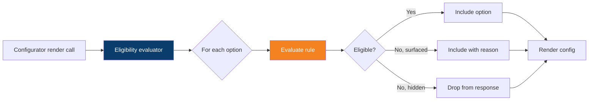

# AlfaCore — Product Configurator JTBD Gap Analysis v1.0

**Scope:** Jobs-To-Be-Done audit of Odoo Product Configurator (and adjacent native capabilities — Optional Products, Combo Choices, Subscription Optional Plans, Pricelists) against the AlfaCore service operating model. Identifies which configurator JTBDs Odoo serves natively, which require configuration or integration, which require custom orchestration, and which belong in future-phase R&D.

**Companion to:** `Alfa-Odoo-Server-Plan-v1.0.md`, `AlfaCore-Service-Plan-v1.0.md`, `AlfaCore-JTBD-Gap-Analysis-v1.0.md`. Fourth and final document in the v1.0 architecture corpus.

**Audience:** Solution architects, Odoo configuration leads, UX/product strategists. Out of audience: front-end implementers (this is architecture, not component spec); content curators (DTC and rule corpora are separate workstreams); brand/marketing operations (those are Nano Banana / OdooIQ deliverables).

**Posture (scope discipline reaffirmed):**

- **In scope:** UX architecture, functional specifications, user journeys, interaction models, data orchestration, API expectations, performance requirements, mobile-first requirements, accessibility expectations, visual-system requirements at the *intent* level.
- **Out of scope:** Final OWL component implementations, production-ready design tokens, animation choreography, completed component libraries, the DTC content corpus, the triage rule corpus, hardware engineering, marketing execution, payment-processor selection, and any other implementation-class deliverable.
- **Classification discipline:** Every gap below carries one of five classes — **N** (Native), **C** (Configuration), **I** (Integration), **X** (Custom development), **R** (Future-phase R&D). Nothing is asserted from generic configurator memory; every Odoo claim is sourced from v19 documentation or a controlled platform inspection.

**Status:** Draft v1.0.

---

## 1. Framework

### 1.1 The native Product Configurator inventory (v19 confirmed)

Odoo 19 ships the following configurator-class primitives:

| Primitive | What it actually does | Edition |
|---|---|---|
| **`product.attribute`** + **`product.attribute.value`** | Defines configurable dimensions and their options | Community |
| **Display types** | Radio, Pills, Color (HTML codes), Select (dropdown), Multi-checkbox (option-style, no variant), Image | Community |
| **Variant Creation Mode** | `Instantly` (pre-generate all combinations), `Dynamically` (create on sale-order), `Never` (no variants — option-style only). **Immutable once an attribute is assigned to a product** | Community |
| **Variant exclusion rules** | Prevents invalid attribute combinations (e.g., "Leather not available in Pink") | Community |
| **Product Configurator pop-up** | Modal that appears when adding a product with ≥2 attributes to a quote | Community |
| **Order Grid Entry** | Alternative bulk-variant entry mode (matrix selection) | Community |
| **Optional Products** | Listed on the Sales tab → Upsell & Cross-sell, surfaced as 0-qty lines on the quote, customer can adjust via portal | Community |
| **Quotation Optional-Products section** | Sale order template construct — items default to qty 0, portal-interactable | Community |
| **Sales Order Templates** | Reusable order skeletons with line items, optional products, validity period | Community |
| **Combo Products** | `Product Type: Combo` with combo choices, max items, included items, extra-price-per-option. **POS- and eCommerce-shaped, not service-quote-shaped** | Community |
| **eCommerce Combo Choices** | `Website > eCommerce > Combo Choices` — bundle configuration for storefront | Community |
| **Pricelists** | Price rules per variant, per partner, per quantity, per period | Community |
| **Subscription Plans** | Recurring billing periods (Weeks/Months/Years — **Days are excluded by design**), recurring prices, automatic closing rules | Enterprise |
| **Subscription Optional Plans** | Enables customer-initiated tier-switching (upgrade/downgrade); new quote generated on switch | Enterprise |
| **Subscription Add Products** | Customer-driven upsell from the portal; generates Upsell quotation on adjustment | Enterprise |

This is a real and respectable inventory. It handles the majority of *attribute-driven* configuration cleanly. It does *not* handle conditional, contextual, or behavioral configuration without extension.

### 1.2 What the configurator does not do natively

| Configurator class | Native? | Notes |
|---|---|---|
| **Attribute-driven variant selection** | ✅ Yes | Core of the configurator |
| **Variant exclusions ("Leather + Pink invalid")** | ✅ Yes | Native exclusion rules |
| **Optional-product upsell on a quote** | ✅ Yes | Native, well-tested |
| **Subscription tier upgrade/downgrade** | ✅ Yes | Native Optional Plans |
| **Conditional logic based on partner data** | ❌ No | Requires custom |
| **Conditional logic based on vehicle data (VIN, mileage, year)** | ❌ No | Requires custom — no native concept of "the customer's car" |
| **Multi-step wizard with progressive disclosure** | ❌ No — the configurator is a single modal | Requires custom |
| **Save-and-resume incomplete configurations** | ❌ No — abandoning the modal discards state | Requires custom |
| **AI-assisted recommendation ranking** | ❌ No | Requires custom |
| **Behavioral/usage-pattern-driven option ordering** | ❌ No | Requires custom |
| **Real-time visual rendering (3D car, vehicle diagram, animated states)** | ❌ No — image swatches only | Requires custom or R&D |
| **Live-collaborative configuration (advisor + customer co-edit)** | ❌ No | Requires custom |
| **Variant-creation-mode change post-assignment** | ❌ No (documented immutability) | Architectural constraint |
| **Days-unit subscription billing** | ❌ No (documented exclusion) | Architectural constraint |

The gap pattern is clear: **Odoo's configurator is excellent at the "what" of configuration (attribute × value) and at the lifecycle integration (quote, sale order, subscription, invoice). It is sparse at the "how" of luxury-grade customer experience (progressive disclosure, contextual personalization, visual narrative).** Both layers earn their place in AlfaCore — but they have different cost shapes.

### 1.3 The luxury benchmark — what Tesla / Apple / Porsche / Rivian actually do

To calibrate "premium configurator" honestly, the relevant patterns from the named benchmarks:

| Pattern | What it actually is | AlfaCore implication |
|---|---|---|
| **Visual primacy** | Configuration changes drive immediate visual update (Tesla's exterior color preview, Porsche's wheel rotation) | Most expensive native gap; reserve for high-value moments (subscription tier, protection plan) |
| **Progressive narrative** | Configuration is staged as a story, not a form (Apple's "Choose your iPhone → Storage → Color → Trade-in → Pay") | Pattern, not module — custom orchestration over native Odoo data |
| **Confidence anchoring** | Each choice is confirmed with social proof, technical justification, or comparative framing | Mostly content discipline + a few custom display patterns |
| **Cost transparency** | Running total visible at all times, with breakdown on hover | Native pricelist + custom display |
| **Defer-not-decide** | "Save and return" persisted across sessions, sometimes shared via link | Custom — no native save-state |
| **Reversible exploration** | Customers can try-and-undo without commitment | Native (quote draft state) + custom UX wrapper |
| **Specialist handoff** | "Talk to a specialist" route at any point in the flow | Native (CRM activity) + custom trigger |
| **Mobile-first** | All flows tablet-and-phone-native, not just responsive | Custom — Odoo portal mobile responsiveness is functional but not premium |

These patterns map cleanly onto JTBDs (§2, §3). Most do not require the native configurator to do more than it does — they require *orchestration over* the configurator, which is a custom module pattern, not a frontend rebuild.

### 1.4 Architectural posture

To stay disciplined across hundreds of decisions, this audit applies four separation rules:

1. **Configuration data lives in Odoo (`product.attribute`, `product.template`, pricelists, sale order templates).** Migration-safe, versionable, admin-managed.
2. **Business rules live in dedicated Python models (`alfa_core_configurator.rule`, `alfa_core_configurator.recommendation`).** Pattern-6 discipline — rules as data, not code branches.
3. **Orchestration lives in Python controllers and JSON-RPC endpoints.** The PWA and back-office views consume orchestration, they don't host it.
4. **Visual rendering lives in OWL components (separate engineering deliverable, not in this audit).** When this document says "the customer sees X," it means X is a *functional* outcome — the visual implementation belongs to a downstream UX engineering workstream.

These rules are the same separation-of-concerns discipline applied in `luxury_painter` and `event_extend`. They mean an OWL component can be replaced without a data migration, and an attribute can be added without a frontend rebuild.

---

## 2. Customer-Side Configurator JTBDs

### 2.1 Subscription Tier Selection

#### JTBD 2.1.1 — Choose the right tier without reading marketing copy

> *When I'm signing up, I want to compare Basic, Premium, and Pro on a single screen with my actual use case framed, so I'm not guessing which tier fits.*

| Aspect | Detail |
|---|---|
| Actor | New customer in onboarding flow |
| Today's friction | Marketing tier-comparison tables are designed to upsell, not to help honest self-selection |
| Native fit | Subscriptions module supports plans with Optional Plans for switching; eCommerce can render plan cards |
| Gap | Use-case framing ("for my 2018 Stelvio at 89K km, this is what each tier covers") requires VIN-aware copy injection |
| Class | **C+X** — native plan structure + custom recommendation injector on the comparison view |
| AlfaCore module | `alfa_core_base` (subscription plans), `alfa_core_configurator` (recommendation injector) |
| Automation | VIN + mileage → plan recommendation pre-selected with rationale |
| KPI | Plan-distribution at signup; downgrade rate within 90 days (mis-selection signal) |
| Risk | Recommendation that mis-fires erodes trust faster than no recommendation — confidence threshold must be conservative |

#### JTBD 2.1.2 — Upgrade without ceremony when my needs change

> *When my warning light comes on and I realize I want technician review, I want to upgrade from Premium to Pro in two taps, so I'm not waiting for billing-cycle reset.*

| Aspect | Detail |
|---|---|
| Native fit | Subscription **Optional Plans** is exactly this capability |
| Class | **N+C** — native flow, configured with the three AlfaCore tiers |
| Gap | Prorated billing UX on upgrade — Odoo's default is end-of-period transition; "immediate access" requires custom proration |
| Automation | Upgrade confirmation → immediate Pro features unlocked → prorated invoice generated |
| KPI | Upgrade conversion rate from in-context triggers (post-diagnosis Pro nudge) |
| Risk | Downgrade flow must be equally frictionless — restricting it triggers regulator attention under PIPEDA fair-dealing principles |

#### JTBD 2.1.3 — See exactly what's included before I subscribe

> *When I'm evaluating Pro tier, I want a complete and honest itemization of what's included and excluded, so I'm not surprised later.*

| Aspect | Detail |
|---|---|
| Native fit | Subscription product description; eCommerce product page |
| Gap | "Honest inclusion/exclusion" as a structured object (not free-text) — what's a feature, what's a limit, what's an upgrade |
| Class | **X** — `alfa_core_configurator.tier.benefit` model with `benefit_type` (feature/limit/upgrade), `value`, `unit`, `comparison_visibility` |
| Automation | Tier comparison view rendered from the structured benefit table |
| KPI | Trial-to-paid conversion; refund-request rate citing "didn't realize" reasons |
| Risk | None significant — additive transparency |

### 2.2 Service-Package Configuration (per-visit)

#### JTBD 2.2.1 — Build my service order from a starting point that's relevant to my car

> *When I'm booking an oil-and-filter service, I want the right oil, the right filter, the right interval — for my exact engine — already populated, so I'm correcting two fields, not building from blank.*

| Aspect | Detail |
|---|---|
| Native fit | Sales Order Templates with predefined lines and optional products |
| Gap | Template selection is currently *static* (operator picks template). VIN/engine-aware template auto-selection is custom |
| Class | **C+X** — multiple Sales Order Templates per service type (one per engine family); custom selector picks the right template |
| AlfaCore module | `alfa_core_configurator.template.selector` chooses among configured templates by `(service_type, platform, engine_code, mileage_band)` |
| Automation | Customer selects "Oil & Filter" → selector queries vehicle profile → correct template pre-loaded |
| KPI | Template hit rate (correct template selected without operator override) |
| Risk | Selector accuracy depends on the customer's vehicle profile being complete — onboarding must capture engine code reliably |

#### JTBD 2.2.2 — Add or skip line items without a hostage situation

> *When the suggested service includes a cabin filter I just replaced, I want to remove it with one tap — not call to "speak to my advisor."*

| Aspect | Detail |
|---|---|
| Native fit | Optional Products on the quote — customer adjusts qty to 0 via portal |
| Class | **N** — native, but UX needs portal-template work to feel luxury-grade |
| AlfaCore module | `alfa_core_portal` overrides the portal sale-order template |
| Automation | Removal triggers no re-approval cycle; addition triggers re-pricing only |
| KPI | Self-service modification rate vs. advisor-handled modification rate |
| Risk | Modifications must not invalidate parts pre-ordering — link removal → cancel reserved part |

#### JTBD 2.2.3 — Understand line-by-line why each item is recommended

> *When my service order has a coolant flush at $180, I want to know whether it's interval-driven or condition-driven, so I can decide if it's the right call.*

| Aspect | Detail |
|---|---|
| Native fit | Sale order line `name` field (free text) |
| Gap | Structured "recommendation rationale" per line — `interval_due` / `condition_observed` / `customer_request` / `safety_critical` / `manufacturer_required` |
| Class | **X** — `sale.order.line.alfa_core_rationale` custom field with a controlled vocabulary |
| AlfaCore module | `alfa_core_configurator` extends `sale.order.line` |
| Automation | Rationale populated from the originating recommendation; visible on portal and printed quote |
| KPI | Line-decline rate stratified by rationale (decline rate for "manufacturer_required" should be near zero — if not, the rationale is misclassified) |
| Risk | None significant; honest transparency increases trust |

### 2.3 Maintenance Plan Configuration (recurring)

#### JTBD 2.3.1 — Subscribe to a maintenance plan tailored to my mileage pattern

> *When I'm offered a 12-month maintenance plan, I want options sized to how I drive — 10K, 20K, 30K km/year — not a generic "12-month plan."*

| Aspect | Detail |
|---|---|
| Native fit | Subscriptions with `product.attribute` for mileage band; pricelists per attribute combination |
| Gap | Mileage-band attribute is straightforward to model. The harder gap: *recommending* the right band based on the customer's actual driving (PID 0x31 distance, scan-history mileage deltas) |
| Class | **N** for the modeling, **X** for the recommendation engine |
| AlfaCore module | `alfa_core_configurator.recommendation` plus a `alfa_fleet.vehicle.driving_pattern` computed model fed by scan history |
| Automation | Plan offer triggered post 90-day scan history → recommended band pre-selected |
| KPI | Recommended-band acceptance; band-mismatch reset rate (customer hits cap before period end) |
| Risk | Aggressive band-undersell to win the sale creates cap-overrun friction later — bias the recommender toward the higher band when uncertain |

#### JTBD 2.3.2 — Bundle services for predictable annual cost

> *When I'm choosing a maintenance plan, I want to bundle oil services, brake inspections, scan coverage, and seasonal checks — and see one annual price.*

| Aspect | Detail |
|---|---|
| Native fit | Subscription products with recurring lines; Optional Plans for tier variants |
| Gap | Combo Products are POS-shaped, not subscription-shaped. Bundling at subscription level requires using subscription `recurring_invoice_line_ids` directly |
| Class | **N+C** — model bundle as a subscription product with multiple included service products, each invoiced as bundled |
| Automation | Bundle selection → all included services pre-allocated to the partner's profile as redeemable |
| KPI | Bundle redemption rate vs. expiration rate |
| Risk | Subscription bundle accounting requires careful revenue-recognition modeling — defer to accounting review before launch |

#### JTBD 2.3.3 — Carry unused services into the next period

> *When I didn't use my second oil change before my plan renewed, I want it carried over — not lost.*

| Aspect | Detail |
|---|---|
| Native fit | None — subscription periods are consumed-or-lost by default |
| Class | **X** — `alfa_core_configurator.benefit.ledger` model tracking earned / consumed / carried benefits per partner per period |
| AlfaCore module | `alfa_core_configurator` |
| Automation | Period close → unconsumed benefits → carry rules applied (capped at one period to prevent indefinite accumulation) |
| KPI | Carryover rate; redemption rate of carried benefits |
| Risk | Carryover policy must be explicit at signup — otherwise it's a perpetual customer-service complaint vector |

### 2.4 Vehicle Protection Plan Configuration

#### JTBD 2.4.1 — Add protection that fits my car's age and value

> *When my Stelvio is 5 years old and 95K km, I want protection options that make sense — not extended warranty pitched the same as for a new car.*

| Aspect | Detail |
|---|---|
| Native fit | Product variants for protection levels |
| Gap | Eligibility logic by age/mileage/condition is not native. Pricing curves by age/mileage are also not native (pricelists support tiered pricing but not "exclude this option above X km") |
| Class | **X** — `alfa_core_configurator.eligibility.rule` per protection-plan variant |
| AlfaCore module | `alfa_core_configurator` |
| Automation | VIN entered → eligible plans surfaced, ineligible plans either hidden or shown with the eligibility reason |
| KPI | Eligibility-hit accuracy (ineligible plans never shown) |
| Risk | Hiding ineligible plans without explanation creates "why can't I have that?" friction — prefer surfaced-with-reason |

#### JTBD 2.4.2 — Understand what's covered without legal-document fatigue

> *When I'm considering a protection plan, I want a one-screen summary of what's in, what's out, and what the deductible looks like.*

| Aspect | Detail |
|---|---|
| Native fit | Product description; QWeb report for full T&Cs |
| Gap | Structured coverage object — same shape as 2.1.3 tier benefits but coverage-class-specific |
| Class | **X** — `alfa_core_configurator.coverage.item` model |
| Automation | Plan selection generates the summary card; Sign module captures customer acknowledgment |
| KPI | Plan-conversion rate; post-claim satisfaction (was coverage clear?) |
| Risk | Legal review required on every coverage change — process discipline, not software |

### 2.5 Concierge Options (loaner, pickup/drop-off, valet)

#### JTBD 2.5.1 — Choose loaner tier without negotiation

> *When I'm booking a 3-day service, I want to pick the loaner tier I'm comfortable with — and see if a Stelvio-equivalent is available — without negotiating.*

| Aspect | Detail |
|---|---|
| Native fit | `product.attribute` for loaner tier (Compact/Mid/Premium/Match-class); Optional Products on service quote |
| Gap | Real-time availability check against the loaner fleet calendar |
| Class | **N+X** — native attribute, custom availability check controller against `alfa_core_loaner` (from prior audit) |
| AlfaCore module | `alfa_core_loaner` + `alfa_core_configurator` |
| Automation | Service date → loaner availability query → only-available tiers shown as selectable |
| KPI | Loaner-tier match rate at booking; loaner-substitution rate at delivery |
| Risk | Calendar accuracy is the limiting factor — `alfa_core_loaner` must be the single source of truth |

#### JTBD 2.5.2 — Schedule pickup and drop-off in the booking flow

> *When I book, I want to schedule a pickup from my office and a drop-off at my home — not call to coordinate.*

| Aspect | Detail |
|---|---|
| Native fit | Field Service module supports task scheduling with multiple locations; Optional Products on service order can carry a "pickup service" line |
| Gap | The geographic constraint (we serve a 30 km radius) and the time-window UX |
| Class | **C+X** — Field Service for the dispatch; custom address validator + service-radius check |
| AlfaCore module | `alfa_core_configurator` for the booking-flow UX wrapper |
| Automation | Address entry → distance check → eligible time slots returned |
| KPI | Pickup-service attach rate; on-time pickup performance |
| Risk | Service-radius scaling is operational, not technical — pickup capacity is the bottleneck |

#### JTBD 2.5.3 — Add valet for an event

> *When I have an event Tuesday night and need the car delivered detailed and parked, I want a one-time concierge upcharge — not a separate booking.*

| Aspect | Detail |
|---|---|
| Native fit | Optional Products on the service quote |
| Gap | "One-time vs recurring" distinction needs to be obvious to the customer — and the upcharge needs to be visible before commit |
| Class | **N+C** — Optional Products, configured cleanly |
| Automation | Selection → field-service task auto-added to the operations calendar |
| KPI | Concierge attach rate by service type |
| Risk | Valet operations require trusted staff; this is a hiring/SOP risk, not a configurator risk |

### 2.6 Diagnostic Bundle Configuration

#### JTBD 2.6.1 — Buy a one-time deep diagnostic without a subscription

> *When I'm considering buying a used Giulia, I want to buy a single pre-purchase inspection scan — no subscription, no commitment.*

| Aspect | Detail |
|---|---|
| Native fit | One-shot products in Sales |
| Gap | The "pre-purchase inspection" is a product whose service-delivery workflow needs Field Service or an in-shop appointment chained to it |
| Class | **N+C** — product + sale order template + Appointments slot |
| Automation | Product purchase → Appointments slot booking required → service order created on slot confirm |
| KPI | One-shot conversion to subscription within 30 days post-service |
| Risk | If conversion is low, the one-shot product cannibalizes the subscription; price the one-shot to make subscription attractive |

#### JTBD 2.6.2 — Bundle scan + interpretation + parts quote as a single workflow

> *When I want a deep diagnostic, I want the scan, the AI interpretation, and a parts/labor quote produced as one deliverable — not three separate steps.*

| Aspect | Detail |
|---|---|
| Native fit | Sales Order Template with multiple lines |
| Gap | The orchestration that chains scan → interpretation → quote-generation is custom (covered by `alfa_core_diagnosis` and `alfa_core_configurator`) |
| Class | **X** — orchestration controller chains the steps and produces the final quote |
| AlfaCore module | `alfa_core_diagnosis` + `alfa_core_configurator` |
| Automation | Bundle purchase → scan event → diagnosis report → quote auto-drafted from recommendations |
| KPI | Bundle-to-service-order conversion rate |
| Risk | None significant; this is the AlfaCore core orchestration |

### 2.7 Seasonal Services

#### JTBD 2.7.1 — Get a "summer prep" or "winter prep" bundle that's right for my car

> *When seasons change, I want a pre-built service bundle that fits my Stelvio's age and trim — not a generic "winter package."*

| Aspect | Detail |
|---|---|
| Native fit | Sales Order Templates per season; eCommerce Combo Choices for the storefront |
| Gap | VIN-aware template selection per §2.2.1 generalizes here |
| Class | **C+X** — reuses the configurator infrastructure from §2.2 |
| Automation | Seasonal trigger (date or temperature-pattern threshold) → eligible customers receive the offer |
| KPI | Seasonal-bundle attach rate; repeat-seasonal conversion |
| Risk | Over-pitching seasonal services to customers who don't drive in winter (Toronto Italian-platform owners overlap with garage-queens) |

### 2.8 Multi-Vehicle Household Bundling

#### JTBD 2.8.1 — Cover all my household's cars on one plan

> *When my household has three Italian cars, I want a household plan — not three parallel subscriptions.*

| Aspect | Detail |
|---|---|
| Native fit | Subscription product with quantity (3 vehicles), pricelist tier for multi-vehicle |
| Gap | Household plan must allocate benefits per vehicle, not in aggregate ("each car gets 2 oil changes" vs "household gets 6 oil changes") |
| Class | **X** — `alfa_core_configurator.benefit.allocation` per vehicle within a single subscription |
| AlfaCore module | `alfa_core_configurator` |
| Automation | Subscription assignment → benefit ledger per VIN |
| KPI | Multi-vehicle adoption; household-plan retention vs single-vehicle retention |
| Risk | Mid-plan vehicle addition/removal needs prorated handling; defer until single-vehicle is stable |

### 2.9 Save-and-Resume Configuration

#### JTBD 2.9.1 — Step away mid-configuration and come back

> *When I'm building a service order, I want to step away and come back tomorrow — without losing what I selected.*

| Aspect | Detail |
|---|---|
| Native fit | Quotes can be saved as drafts in the portal |
| Gap | Mid-configurator state (during the modal flow) is not persisted natively. Closing the modal mid-flow discards in-progress state |
| Class | **X** — `alfa_core_configurator.session` model storing in-progress configuration state, keyed by partner + vehicle + timestamp |
| Automation | Modal close → state snapshot; modal reopen → state restored |
| KPI | Configuration-completion rate; configuration-resume rate |
| Risk | State models age; expiry policy must be explicit (30 days) and surfaced to the customer |

#### JTBD 2.9.2 — Share an in-progress configuration with my partner

> *When I'm building a configuration and want my husband's input, I want to send him a link he can review and edit.*

| Aspect | Detail |
|---|---|
| Native fit | Portal share via secure token (used for quote review) |
| Class | **N+C** — same token mechanism, applied to the configurator session |
| AlfaCore module | `alfa_core_configurator` controller extension |
| Automation | "Share" action → signed URL emailed to specified recipient |
| KPI | Share-link conversion rate (configurations completed after share) |
| Risk | Token security — same posture as portal share tokens, no novel attack surface |

### 2.10 VIN-Aware Option Pruning

#### JTBD 2.10.1 — Only show me options that work on my car

> *When I'm configuring a service, I don't want to see options that don't apply to my model — "Multi-Air solenoid replacement" should not appear if my engine doesn't have Multi-Air.*

This is the master gap that recurs across all customer-side configurator JTBDs above.

| Aspect | Detail |
|---|---|
| Native fit | Variant exclusion rules can prevent invalid attribute combinations — but only based on attribute, not on partner/vehicle context |
| Gap | "Show option only if vehicle.engine_code = 'GME 2.0T'" is the core conditional pattern, repeated across dozens of options |
| Class | **X** — `alfa_core_configurator.eligibility.rule` model. Each rule binds (product, attribute, attribute_value) to a predicate over `vehicle` fields |
| AlfaCore module | `alfa_core_configurator` |
| Automation | Configurator render call → eligibility evaluator → filtered option set returned |
| KPI | Pruning accuracy (false-positive option appearance); pruning latency (must be <100ms to feel native) |
| Risk | **The single highest-leverage custom layer in this audit.** Without it, every configurator JTBD degrades to a marketplace experience. With it, the configurator feels Tesla-grade. |

---

## 3. Service-Side Configurator JTBDs

### 3.1 Advisor — Real-time Quote Building

#### JTBD 3.1.1 — Build a quote while the customer is on the phone

> *When a customer calls about a clunk, I want to build a plausible quote in under five minutes — using the same configurator the customer would use — so we're aligned on what's being offered.*

| Aspect | Detail |
|---|---|
| Native fit | Sales quote with templates; advisor uses backend configurator |
| Gap | Backend configurator should be the **same configurator** the customer sees (parity), not a separate sales-only UI |
| Class | **X** — single configurator orchestration layer serves both customer portal and back-office advisor view |
| AlfaCore module | `alfa_core_configurator` |
| Automation | Advisor selection → customer sees identical quote in portal |
| KPI | Phone-to-portal-parity rate (quotes match exactly); advisor quote-build time |
| Risk | Divergence between front-office and back-office views is a chronic Odoo customization failure mode — guard with strict view-template sharing |

#### JTBD 3.1.2 — Co-edit a quote with the customer live

> *When the customer is on the phone, I want to make a change in my view and have them see it in their portal immediately — not "let me email you an updated version."*

| Aspect | Detail |
|---|---|
| Native fit | Discuss provides websocket transport; quotes update on save |
| Gap | Real-time push of quote changes to the customer's open portal session |
| Class | **C+X** — websocket subscription on the portal quote view; automatic refresh on `sale.order.write` |
| AlfaCore module | `alfa_core_portal` |
| Automation | Quote save → push to subscribed customer session |
| KPI | Co-edit session usage; phone-call duration reduction |
| Risk | Push storms during heavy advisor activity — debounce at the server |

### 3.2 Foreman / Service Manager — Service Template Design

#### JTBD 3.2.1 — Author new service templates without dev help

> *When I want to introduce a "Quadrifoglio Track Day Prep" service, I want to author it in the backend — not file a ticket and wait two weeks.*

| Aspect | Detail |
|---|---|
| Native fit | Sales Order Templates are admin-authorable; Studio can extend with custom fields |
| Class | **N** — for plain template creation. **C** if VIN-aware selector rules need to be authored (UI for `alfa_core_configurator.template.selector` rules) |
| AlfaCore module | `alfa_core_configurator` admin UI |
| Automation | Template publish → eligibility evaluator picks it up automatically |
| KPI | Template-authoring velocity (templates added per month) |
| Risk | Authoring without testing produces buggy customer-facing offerings — staging environment required |

#### JTBD 3.2.2 — Retire or version templates without breaking past quotes

> *When I update the "12K Service" template, I want old quotes still tied to the old version — not silently migrated.*

| Aspect | Detail |
|---|---|
| Native fit | Sales Order Templates use a flat structure; versioning is via duplicate-and-activate |
| Gap | Explicit version field with parent-child lineage |
| Class | **X** — `alfa_core_configurator.template.version` extension on `sale.order.template` |
| AlfaCore module | `alfa_core_configurator` |
| Automation | Template edit → version increment; old quotes retain pointer to original version |
| KPI | Version-mismatch audit (quotes inheriting unintended new versions) — should be zero |
| Risk | None significant if discipline holds |

### 3.3 Parts Manager — Kit / Bundle Definition

#### JTBD 3.3.1 — Define parts kits that match service templates

> *When the "12K Service" template needs an oil kit + filter kit + cabin filter kit, I want those kits defined once and reused everywhere.*

| Aspect | Detail |
|---|---|
| Native fit | Product Bundles via Product Type: Combo (POS-shaped) or via custom kit modules from the Odoo Apps Store |
| Gap | Combo Products are POS-and-eCommerce-shaped; a service-quote-shaped kit needs custom modeling |
| Class | **X** — `alfa_parts.kit` model (custom) tying multiple parts SKUs into a kit usable in sale-order-template lines |
| AlfaCore module | `alfa_parts` extension |
| Automation | Kit selection in template auto-expands to component lines on quote |
| KPI | Kit-driven order rate; kit-component-stockout rate |
| Risk | Kits whose components diverge in price over time need re-pricing logic — track at parts-master level |

#### JTBD 3.3.2 — Manage aftermarket alternatives within a kit

> *When OEM oil filter is out of stock, I want the kit to gracefully substitute the approved Wix or Mahle equivalent — not block the entire service.*

Cross-reference: `alfa_parts.alternative` model from the prior JTBD analysis (P1.9). Same model serves the kit substitution logic.

| Class | **X** — reuses prior infrastructure |
| Automation | Kit fulfillment checks OEM availability → falls back to approved alternative → flags substitution on the quote |
| Risk | Substitution must be transparent to the customer; never silent |

### 3.4 GM / Ownership — Tier Composition

#### JTBD 3.4.1 — Compose new subscription tiers from existing service products

> *When I want to launch a "Stelvio Quadrifoglio Pro" tier with track-day inspections included, I want to compose it from existing products — not rebuild from scratch.*

| Aspect | Detail |
|---|---|
| Native fit | Subscription products with multiple included service products |
| Class | **N+C** — native subscription composition; some custom UI for benefit-ledger setup |
| AlfaCore module | `alfa_core_configurator` benefit-allocation model from §2.3.2 |
| Automation | New tier activation → existing subscribers see it as an Optional Plan upgrade |
| KPI | Tier-experiment velocity; tier-uptake distribution |
| Risk | Tier proliferation confuses customers — discipline the count |

---

## 4. Architectural Patterns

### 4.1 Data model — what's `product.attribute` vs. what's custom

The first architecture call: which dimensions of configuration are modeled as `product.attribute` (variant-creating or option-only) vs. as custom models.

| Dimension | Model as | Rationale |
|---|---|---|
| Subscription tier (Basic/Premium/Pro) | `product.attribute` (variant-creating) | Native subscription product variants; each tier is a real SKU |
| Loaner class (Compact/Mid/Premium/Match) | `product.attribute` (option, multi-checkbox) | Option per service order, not a variant explosion |
| Oil weight (0W-20 / 0W-30 / 5W-40) | `product.attribute` (option) — but ALSO a `alfa_fleet.vehicle.preference` field | Dual: catalog-level option AND customer preference. Catalog drives the configurator; preference drives the default selection |
| Service interval band (12K/24K/36K) | `product.attribute` (variant-creating) on the service product | Each band is a discrete product variant with its own price |
| Mileage-band for plans | `product.attribute` (variant-creating) on the subscription | Same |
| Engine code (GME 2.0T / 2.9 V6) | **NOT** `product.attribute` — `alfa_fleet.engine` master record | Engine is a *vehicle property*, not a product variant. Used by eligibility rules. |
| Year band | **NOT** `product.attribute` — `alfa_fleet.vehicle.year` | Same |
| FAD / Non-FAD | **NOT** `product.attribute` — `alfa_fleet.vehicle.has_fad` Boolean | Same |
| Add-on (cabin filter, alignment) | Optional Product on the template | Native Optional Products is exactly this |
| Concierge add-on (pickup, valet) | Optional Product on the template | Same |

**The discipline:** anything that's a property of the *customer's car* lives on `alfa_fleet`. Anything that's a property of the *thing being sold* lives on `product.template` (or its attributes). The eligibility rule layer (§4.3) joins them.

### 4.2 Conditional Logic Layer

The single most important custom layer. Architecture:



| Component | Class | Purpose |
|---|---|---|
| `alfa_core_configurator.eligibility.rule` | **X** | Stores predicates (product or attribute × condition over partner/vehicle/subscription state) |
| `alfa_core_configurator.eligibility.evaluator` | **X** | Service class evaluating rules against context |
| `alfa_core_configurator.eligibility.reason` | **X** | Per-rule explanation surfaced when option is shown with-reason or hidden |

**Rule shape (data, not code, per Pattern 6):**

```
target: product.template.id OR (product.template.id, attribute_value.id)
condition: domain expression evaluated against (partner, vehicle, subscription)
mode: hide | surface_with_reason | block
reason_key: i18n key for the customer-facing message
priority: int (higher overrides lower)
```

This single layer satisfies the VIN-aware pruning JTBD (§2.10), the protection-plan eligibility JTBD (§2.4.1), the maintenance-band recommendation JTBD (§2.3.1), and the seasonal-service VIN-awareness JTBD (§2.7.1). One layer, many JTBDs — the highest-ROI custom module in the configurator surface.

### 4.3 VIN-Driven Option Pruning

Specialization of §4.2. The rule predicates have first-class access to `alfa_fleet.vehicle` fields:

| Predicate axis | Examples |
|---|---|
| Platform | `vehicle.platform_id.code in ['giorgio', 'mqf']` |
| Engine | `vehicle.engine_code == 'GME_2_0T'` |
| Year band | `vehicle.year >= 2017` |
| Mileage band | `vehicle.last_mileage_km > 100000` |
| Trim | `vehicle.trim_id.code == 'quadrifoglio'` |
| Configuration | `vehicle.has_fad == True` |
| Driving pattern | `vehicle.driving_pattern.annual_km > 25000` |
| Service history | `vehicle.has_service_event('transfer_case_fluid', within_days=730)` |

Performance constraint: rule evaluation must complete within **100ms** for a typical configurator render call (~50 options to evaluate). This is achievable with proper indexing on `alfa_core_configurator.eligibility.rule.target_product_id` and caching of `vehicle.driving_pattern` aggregates. Above 100ms, the configurator stops feeling native and starts feeling like a web form.

### 4.4 Recommendation Orchestration

Distinct from eligibility (which filters), recommendation **ranks**. Architecture:

| Component | Class | Purpose |
|---|---|---|
| `alfa_core_configurator.recommendation.signal` | **X** | A unit of signal — "this customer's last 3 scans showed deferred maintenance," "this engine at this mileage typically benefits from X" |
| `alfa_core_configurator.recommendation.weight` | **X** | Configurable weights per signal type per context |
| `alfa_core_configurator.recommendation.engine` | **X** | Combines signals with weights to produce ranked recommendations |

The recommendation engine consumes:

- Scan history (`alfa_core.scan.session`)
- Service history (`alfa_service.order`)
- Vehicle profile (`alfa_fleet.vehicle`)
- Subscription state (`alfa_core.subscription`)
- Triage outputs (`alfa_core.diagnosis.report`) — links back to the prior audit's diagnosis layer

Output: a ranked list of `recommended_product_id` with `confidence` and `rationale_key`. The configurator UI then renders the top N with rationale.

**Honest boundary:** the recommendation engine ranks, it does not auto-select. A recommendation that auto-selects is a sale that didn't consent.

### 4.5 Save-State and Resume Orchestration

| Component | Class | Purpose |
|---|---|---|
| `alfa_core_configurator.session` | **X** | In-progress configuration state, partner-scoped, vehicle-scoped, with TTL |
| Session token | **X** | Signed URL token for share-and-resume per §2.9.2 |
| Cleanup cron | **X** | Expired sessions purged daily |

State shape is intentionally generic: a JSON blob plus a `configurator_type` discriminator. Each configurator type (subscription, service, maintenance, protection) defines its own state schema.

### 4.6 Subscription Tier-Switching Orchestration

Native Optional Plans handles the data-layer switch. The custom orchestration handles:

- **Prorated immediate access** (§2.1.2) — customer pays upgrade prorated, gets Pro features immediately, not at next cycle
- **Downgrade grace** — customer downgrades, Pro features remain to end of current period
- **Lateral switch** — same-price tier change (rare; placeholder for future protection-plan structure)

Class: **N+C** — native data model, custom proration logic.

### 4.7 Pricing Orchestration

Pricelists are powerful native. The configurator pricing surface:

| Pricing axis | Native? | Notes |
|---|---|---|
| Per-customer pricing | ✅ Yes | Native pricelist per partner |
| Per-quantity tiers | ✅ Yes | Native quantity rules |
| Per-period pricing (subscription) | ✅ Yes | Native recurring prices |
| Per-variant pricing | ✅ Yes | Native via attribute extra-price |
| Per-vehicle-condition pricing | ❌ No | Custom — mileage-band, age-band pricing |
| Per-engine-complexity pricing | ❌ No | Custom — 2.0T vs 2.9 V6 service labor differs |
| Bundle discount | ✅ Yes | Native via pricelist or via Combo extra-price |
| Membership-discount on standalone services | ✅ Yes | Native pricelist per partner-tag |

Class for the custom pricing axes: **X**. Implementation: a `compute_alfa_core_extra` method on `sale.order.line` evaluating mileage/engine/condition adjustments after native price computation.

### 4.8 Combo vs. Optional Products vs. Subscription Plans — when to use which

A common Odoo customization failure mode is reaching for the wrong primitive. The decision table:

| Configuration class | Use this | Reason |
|---|---|---|
| Subscription tier with feature variants | Subscription Optional Plans | Native upgrade/downgrade path |
| Service quote with add-ons | Sales Order Template + Optional Products | Native portal interaction, qty-adjustable |
| Storefront bundle (one-time purchase) | eCommerce Combo Choices | Native bundle UI on website |
| POS combo offer | Combo Product (POS) | Designed for POS terminal |
| Service kit of parts (consumed by template line) | Custom `alfa_parts.kit` | Combo is POS-shaped; custom is cleaner |
| Maintenance plan with per-vehicle benefits | Custom `alfa_core_configurator.benefit.allocation` | No native primitive |
| Bundle of services across a year | Custom `alfa_core_configurator.benefit.ledger` | Subscriptions don't natively model multi-event entitlement |

The two custom primitives — `benefit.allocation` and `benefit.ledger` — are the main subscription-side custom layer.

---

## 5. Premium UX Architecture (Intent, Not Implementation)

This section specifies **what the experience must feel like** without specifying **how to build it**. Component-level decisions belong to a separate frontend engineering deliverable.

### 5.1 Trust-design principles

Six principles, each stated as a non-negotiable:

1. **Visible cost at all times.** Running total never disappears from view; breakdown one tap away.
2. **No surprise charges.** Every fee — subscription, service, parts, concierge, taxes — is itemized before commit. Any fee invisible at commit time is a refundable defect.
3. **Decisions are reversible.** Any selection can be changed up to the commit moment; commit is a separate, explicit act.
4. **Specialist always reachable.** A "talk to a specialist" affordance is present in every step of every configurator. Never gates the customer from human contact.
5. **No dark patterns.** No countdown timers ("only 2 left"), no pre-checked upsells, no scarcity manipulation. Italian-platform owners read forums; they recognize manipulation immediately.
6. **Honest absence.** When an option doesn't apply (eligibility prune), the system says so plainly — not silently. Hiding is worse than transparent ineligibility.

### 5.2 Progressive Disclosure Intent

The configurator surface must reveal complexity in proportion to the customer's expressed engagement level. Three layers:

| Layer | Information density | When |
|---|---|---|
| **Surface** | Summary + 2–3 primary choices + clear next action | Default state, mobile-first |
| **Detail** | Full attribute matrix, eligibility explanations, comparison table | Customer expands or "compare" tap |
| **Deep** | Full T&Cs, rationale per recommendation, full benefit ledger | Customer drills into "Why this?" |

The native Odoo configurator modal is **Surface-only**. Detail and Deep are custom orchestration layers — but they consume the same underlying configurator data.

### 5.3 Confidence-Building Micro-Patterns

Identified patterns (architectural intent only; design execution is a separate deliverable):

| Pattern | Where it applies | Class |
|---|---|---|
| "Why this recommendation?" expandable | Every recommended option | **X** — rationale data already in §4.4 |
| Comparative framing (this tier vs. others at this mileage band) | Tier selection | **X** |
| Social proof at the platform level (not the individual) | "Other 2018 Stelvio owners typically..." | **X** + data privacy review |
| Service-history reference inline | "Your last brake inspection was 14 months ago" | **N** — chatter data, custom display |
| Confidence indicator on recommendations | High/medium/low confidence pill | **X** — confidence already computed in §4.4 |

### 5.4 Mobile-First Interaction Model

The configurator is designed mobile-first, not desktop-first responsive. Implications:

- **One choice per screen** for primary flow on phone-width viewports
- **Tap targets ≥ 44pt** (Apple HIG / Material guidelines)
- **No hover-dependent affordances**; everything is tap-revealable
- **Keyboard avoidance**: numeric inputs use steppers, dates use native pickers, free-text minimized
- **Performance budget**: configurator render < 2s on 3G, < 1s on LTE
- **Gesture support**: swipe between configuration steps (where steps exist)

Class: these are functional requirements that the frontend engineering deliverable must honor. Not in this audit's implementation scope.

### 5.5 Accessibility Expectations

| Requirement | Standard |
|---|---|
| Visual contrast | WCAG 2.2 AA minimum for the configurator; AAA for safety-critical messaging |
| Keyboard navigation | Full traversal; no mouse-only paths |
| Screen reader | All configurator state changes announced via ARIA live regions |
| Color independence | No information conveyed by color alone (severity uses color + icon + text) |
| Reduced motion | `prefers-reduced-motion` respected for any animation pattern |
| Language support | English and French at launch (Canadian context); Italian for Maranello-network customers |

Class: requirements, not implementation. The frontend deliverable owns the execution.

### 5.6 Motion and Animation Intent

Motion is content. Specified at the intent level:

| Intent | Where | Functional purpose |
|---|---|---|
| Confirm a commit | After "Place order" tap | Visual closure on a major action |
| Acknowledge a selection | After picking an option | Confidence that the system registered the choice |
| Direct attention | When a related option becomes available/unavailable due to prior choice | Pruning is visible, not silent |
| Convey progress | Multi-step configurator | Step-out-of-N indicator |
| Indicate state transition | Service order moving from "draft" to "in progress" to "ready" | Mirrors the underlying state machine |

Motion that does not serve one of these intents is decoration and is excluded.

### 5.7 Service-State Visualization Intent

The customer should be able to see, at a glance, where their service order is — without reading paragraphs. The state space:

| State | Customer-facing label | Visual treatment intent |
|---|---|---|
| `draft` | "We're preparing your quote" | Quiet, no urgency |
| `sent` | "Your quote is ready to review" | Action-required, advance signal |
| `confirmed` | "We've got it — see you on [date]" | Confirmation, satisfaction |
| `parts_ordered` | "Your parts are on the way" | Logistics-state, neutral |
| `in_progress` | "Your car is in the bay" | Active, attention-respectful |
| `inspection_findings` | "We found something — review needed" | Action-required, no alarm |
| `ready_for_pickup` | "Your car is ready" | Celebratory, restrained |
| `picked_up` | "Thanks — see you next time" | Closed, warm |
| `awaiting_review` | "How did we do?" | Soft invitation, not pressure |

Class: **C+X** — state labels native, state-visualization custom. The visual implementation is a frontend deliverable.

### 5.8 Visual Configurator Intent

For high-value moments (subscription tier, protection plan), a visual representation of the choice may justify the implementation cost. **What this audit specifies:**

- **Intent**: visualize the *outcome* of the configuration choice (what's covered, what's included, what changes)
- **Not specified**: 3D vehicle rendering, animated wheel rotation, photoreal car previews

The visual configurator opportunity is **R** (future-phase R&D). Acceptable v1: a clear coverage diagram (SVG-based) showing what each tier covers. Anything beyond that is post-pilot.

---

## 6. Module Map — Where Capability Lives

| Capability | Native | Configuration | Integration | Custom | Future R&D |
|---|:-:|:-:|:-:|:-:|:-:|
| Attribute-driven variants | ✓ | | | | |
| Variant exclusion rules | ✓ | | | | |
| Optional products on quote | ✓ | | | | |
| Sales Order Templates | ✓ | | | | |
| Subscription Optional Plans | ✓ | | | | |
| eCommerce Combo Choices | ✓ | | | | |
| Pricelists (variant/partner/qty) | ✓ | | | | |
| Display types (radio, color, image) | ✓ | | | | |
| VIN-aware option pruning | | | | ✓ | |
| Conditional logic (vehicle/customer context) | | | | ✓ | |
| Recommendation ranking engine | | | | ✓ | |
| Save-and-resume configuration | | | | ✓ | |
| Share-and-resume via link | | ✓ | | ✓ | |
| Real-time co-edit (advisor + customer) | | ✓ | | ✓ | |
| Multi-step progressive disclosure | | | | ✓ | |
| Mileage-band / age-band pricing | | | | ✓ | |
| Per-vehicle benefit allocation | | | | ✓ | |
| Benefit ledger (with carryover) | | | | ✓ | |
| Parts kits (service-quote-shaped) | | | | ✓ | |
| Aftermarket alternative substitution | | | | ✓ | |
| Template versioning with lineage | | | | ✓ | |
| Mobile-first interaction model | | | | (frontend deliverable) | |
| WCAG 2.2 AA conformance | | | | (frontend deliverable) | |
| Visual configurator (SVG coverage diagram) | | | | ✓ | |
| 3D vehicle preview rendering | | | | | ✓ |
| Live-collaborative configuration (CRDT-grade) | | | | | ✓ |
| ML-driven recommendation training | | | | | ✓ |
| Voice-driven configurator (advisor on phone) | | | | | ✓ |

**Tally:** 8 capabilities native, 2 light configuration, 14 custom, 4 future R&D. The custom layer concentrates in two modules (`alfa_core_configurator` and extensions to `alfa_parts`). Both are scoped in §7.

---

## 7. Prioritized Configurator Gap Register

### 7.1 P0 — Required for pilot launch

| # | Gap | JTBD ref | Class | Effort | Module |
|---|---|---|---|---|---|
| C.P0.1 | Eligibility/conditional-logic layer (VIN-aware pruning) | 2.10 | X | 3 weeks | `alfa_core_configurator` |
| C.P0.2 | Subscription tier configuration with Optional Plans | 2.1 | N+C | 0.5 weeks | (config of native) |
| C.P0.3 | Sales Order Templates per service type + engine family | 2.2.1, 2.7.1 | C | 1 week | (config of native) |
| C.P0.4 | Per-line recommendation rationale | 2.2.3 | X | 0.5 weeks | `alfa_core_configurator` |
| C.P0.5 | Save-and-resume session model | 2.9.1 | X | 1 week | `alfa_core_configurator` |
| C.P0.6 | Portal sale-order template override (luxury-grade itemization) | 2.2.2, 2.2.3 | C | 1 week | `alfa_core_portal` |
| **P0 subtotal** | | | | **~7 weeks** | |

### 7.2 P1 — Required for Pro-tier viability

| # | Gap | JTBD ref | Class | Effort | Module |
|---|---|---|---|---|---|
| C.P1.1 | Recommendation ranking engine | 2.1.1, 2.3.1, others | X | 3 weeks | `alfa_core_configurator` |
| C.P1.2 | Benefit ledger with carryover | 2.3.3 | X | 2 weeks | `alfa_core_configurator` |
| C.P1.3 | Loaner real-time availability check in configurator | 2.5.1 | X | 1 week | `alfa_core_configurator` + `alfa_core_loaner` |
| C.P1.4 | Maintenance-plan with per-vehicle benefit allocation | 2.3.2, 2.8.1 | X | 2 weeks | `alfa_core_configurator` |
| C.P1.5 | Parts kits (service-quote-shaped) | 3.3.1 | X | 1.5 weeks | `alfa_parts` |
| C.P1.6 | Prorated upgrade with immediate access | 2.1.2 | C | 1 week | `alfa_core_base` |
| C.P1.7 | Advisor / customer parity view | 3.1.1 | X | 1.5 weeks | `alfa_core_configurator` |
| C.P1.8 | Share-and-resume via signed link | 2.9.2 | N+C | 0.5 weeks | `alfa_core_configurator` |
| C.P1.9 | Template versioning with lineage | 3.2.2 | X | 1 week | `alfa_core_configurator` |
| **P1 subtotal** | | | | **~13.5 weeks** | |

### 7.3 P2 — Differentiator / post-pilot

| # | Gap | JTBD ref | Class | Effort | Module |
|---|---|---|---|---|---|
| C.P2.1 | Live co-edit (advisor + customer) | 3.1.2 | X | 2 weeks | `alfa_core_configurator` + `alfa_core_portal` |
| C.P2.2 | Mileage/age-band pricing adjustments | 4.7 | X | 1 week | `alfa_core_configurator` |
| C.P2.3 | Service-history-aware recommendations | 5.3 | X | 1.5 weeks | `alfa_core_configurator` |
| C.P2.4 | SVG coverage diagram for tier comparison | 5.8 | X | 2 weeks | (frontend deliverable) |
| C.P2.5 | Multi-step progressive disclosure orchestration | 5.2 | X | 1.5 weeks | `alfa_core_configurator` |
| **P2 subtotal** | | | | **~8 weeks** | |

### 7.4 P3 — Backlog

3D vehicle rendering, live-collaborative CRDT-grade configurator, ML-driven recommendation training pipeline, voice-driven advisor configurator, AR-based add-on previews.

### 7.5 Total configurator effort

- **P0 — pilot-ready configurator surface:** ~7 weeks single-engineer
- **P0 + P1 — Pro-tier-grade:** ~20.5 weeks
- **P0 + P1 + P2 — differentiated luxury experience:** ~28.5 weeks

These costs stack on top of the prior audit's P0/P1/P2 estimates. The configurator layer is **additive**, not replacement.

---

## 8. Risks

### 8.1 Architectural risks

| Risk | Likelihood | Severity | Mitigation |
|---|---|---|---|
| Variant Creation Mode wrong at first assignment (immutable thereafter) | Moderate | High | Pre-launch architecture review; choose Dynamically for all service-configurable products |
| Eligibility-rule complexity exceeds 100ms render budget | Moderate | High | Index target_product; cache vehicle aggregates; load-test at 50-rule scenarios |
| Configurator divergence between portal and back-office | High over time | High | Strict view-template sharing; CI test for parity |
| Combo Products misused for service quotes | Moderate | Moderate | Decision table §4.8 codified in developer documentation |
| Subscription Days-unit limit forces awkward weekly-trial UX | Low | Low | Use 1-week minimum trial; document the constraint |

### 8.2 Customer-experience risks

| Risk | Likelihood | Severity | Mitigation |
|---|---|---|---|
| Eligibility pruning hides options the customer expected to see | Moderate | High | Default to surface-with-reason, not hidden |
| Recommendation engine over-confidence | Moderate | High | Confidence threshold; never auto-select |
| Save-state expiry surprises the customer | Low | Moderate | Explicit TTL surfaced; reminder before expiry |
| Bundle-redemption confusion | Moderate | High | Benefit ledger must show clearly; not buried in subscription detail |
| Tier-switching proration math wrong | Low | Critical | Test matrix for all tier-to-tier transitions; finance review |

### 8.3 Operational risks

| Risk | Likelihood | Severity | Mitigation |
|---|---|---|---|
| Template proliferation beyond manageable count | High over time | Moderate | Versioning + retirement workflow; quarterly template-audit cadence |
| Pricelist + attribute extra-price + custom pricing → unpredictable totals | Moderate | High | Single "compute_total" path; pricing test fixtures |
| Studio overuse leading to upgrade-fragility | Moderate | Moderate | Studio for cosmetic only; custom modules for business logic |

---

## 9. Honest Exclusions

Reaffirmed scope discipline:

- **No OWL component implementations** in this document. Frontend engineering is a separate deliverable.
- **No DTC content corpus** in this document. The taxonomy, schema, seeding strategy, and moderation workflow are addressed at the architecture level only — actual content is curation labor.
- **No triage rule corpus** in this document. The engine architecture supports rules-as-data; the rules themselves evolve over time.
- **No hardware engineering.** Vendor-baseline strategy is reaffirmed; branded reference unit is post-volume R&D.
- **No marketing-site implementation.** API contracts and CRM-capture hooks specified; site execution is Nano Banana / OdooIQ.
- **No payment processor selection.** Architecture is processor-agnostic; `sale.order → account.move` lifecycle integrity is the only commitment.
- **No design-system execution.** Visual intent specified; design tokens, typographic scales, animation curves, color systems are downstream UX engineering deliverables.
- **No 3D rendering / AR / advanced visualization.** Future R&D.

---

## 10. Decisions This Audit Requires

Decisions blocking P0 work:

1. **Variant Creation Mode for all service-configurable products.** Recommendation: **Dynamically**. This is a one-way door — confirm before any attribute is assigned to any service product.

2. **Eligibility rule authoring UX.** Two paths:
   - **(a)** Admin authors rules via Studio-extended forms — accessible but verbose
   - **(b)** Custom rule-builder UI in `alfa_core_configurator` — better UX, +1 week effort
   - Recommendation: (a) for v1, (b) for v1.1 if rule volume justifies.

3. **Recommendation engine inference disposition.** Local-only (rule-based ranking, no LLM) or LLM-augmented (Ollama for tier-recommendation rationale prose)? Same ZDE-vs-Claude question as the diagnosis engine in the Service Plan §8.2. Recommendation: rule-based for v1; LLM polish opt-in post-pilot.

4. **Benefit ledger carryover policy.** Forever-rolling, capped at one period, or expires at period end? Recommendation: capped-at-one-period for v1; the simplest defensible policy. Forever-rolling creates accounting complexity.

5. **Configurator-parity testing.** How is portal-vs-back-office parity enforced? Recommendation: automated visual-regression test against a fixed scenario matrix in CI.

6. **Save-state TTL.** 7 days, 30 days, or 90 days? Recommendation: 30 days with auto-extension on activity. Long enough to allow shopping cycles; short enough to prevent stale-state confusion.

7. **Live co-edit prioritization.** P1 or P2? Operationally valuable for the advisor; technically demanding (websocket plumbing). Recommendation: P2 for v1.1, after pilot validates demand.

8. **Visual configurator scope.** SVG-only at v1 (§5.8) or skip entirely until post-pilot? Recommendation: skip entirely; the rationale-and-pricing transparency wins do more for trust than visual eye-candy.

---

**End of analysis v1.0.**

*Fourth document in the AlfaCore architecture corpus, alongside `Alfa-Odoo-Server-Plan-v1.0.md`, `AlfaCore-Service-Plan-v1.0.md`, and `AlfaCore-JTBD-Gap-Analysis-v1.0.md`. Next review: after Variant Creation Mode decision (#1) lands and the eligibility rule authoring UX choice (#2) is made.*
