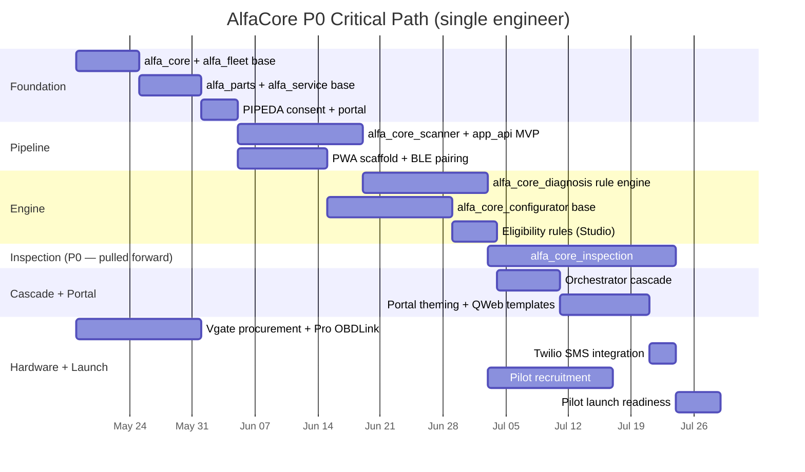

# AlfaCore — Decision Log v1.0

**Status:** All twelve open decisions from the corpus resolved. Architecture phase complete. Phase 1 execution unblocked.

**Decision session:** May 11, 2026.

**Companion to:** the five-document architecture corpus.

---

## Decision Table

| # | Decision | Resolution | Source ref |
|---|---|---|---|
| 1 | Variant Creation Mode for service-configurable products | **Dynamically** (immutable, all service products) | Configurator audit §10.1 |
| 2 | Eligibility rule authoring UX | **Studio-first at v1**, custom builder if volume justifies in v1.1 | Configurator audit §10.2 |
| 3 | Recommendation engine inference at v1 | **Rule-based only**, LLM polish opt-in post-pilot | Service Plan §8.2 |
| 4 | Benefit ledger carryover policy | **Capped at one period** | Configurator audit §10.4 |
| 5 | Configurator save-state TTL | **30 days with auto-extension on activity** | Configurator audit §10.6 |
| 6 | Pilot cohort size | **5–10 customers** (white-glove pilot) | JTBD Gap §6.5 |
| 7 | Inspection module priority | **P0** — pulled forward from P1 to ship at pilot | JTBD Gap §6.2 (P1.1 → P0) |
| 8 | WhatsApp Business API at launch | **Defer to v1.1** — SMS + email at launch | JTBD Gap §4.1 |
| 9 | Scanner hardware vendor | **Vgate iCar Pro BLE 4.0** baseline; **OBDLink MX+** included with Pro tier | Service Plan §6.1 |
| 10 | Brand vs. Italian-platform scope | **Alfa-only at v1**; Fiat / Maserati added in v1.1 | Service Plan §13.7 |
| 11 | Substrate promotion threshold | **QNAP through pilot**; promote to cloud VM at 50 customers OR resource ceiling | Service Plan §13.8 |
| 12 | Telephony vendor | **Twilio SMS** at v1; voice integration deferred to v1.1 | Blueprint §15.2 |

---

## Architectural Consequences

### What these decisions lock in

1. **Catalog discipline.** Every service-configurable product uses Dynamically. No phantom-SKU explosion across engine × mileage × interval × concierge dimensions. Decision #1 is the one-way-door that prevents an entire class of operational pain.

2. **Pilot scope is bounded.** 5–10 white-glove customers means the P0/P1 classification in the audits holds as written. No mid-pilot P0/P1 reclassification triggered by scale.

3. **Pro tier ships at full strength.** Inspection module at P0 means the Pro proposition launches with the photo/video-per-inspection-point workflow that distinguishes AlfaCore from generic OBD apps. Pro tier customers pay $59/mo and get concierge service, not an expensive scan subscription.

4. **ZDE preserved at v1.** Rule-based recommendation + no Ollama plumbing at launch + no Claude API calls = customer scan data does not leave the AlfaCore host during inference at pilot. The PIPEDA story is clean.

5. **Brand consistency restored.** "AlfaCore" with Alfa-only scope at v1 eliminates the brand-name dissonance the audits flagged. v1.1 expansion to Fiat / Maserati is a data-model-safe migration, not a schema change — `alfa_fleet.platform` and `alfa_fleet.engine` are records, not enums.

6. **Substrate decision is objective.** Cloud promotion triggers on 50 customers OR observable resource saturation — whichever arrives first. No vibes-based migration debate; trigger is measurable.

### What gets deferred to v1.1

| Deferred capability | Why deferred | Re-trigger condition |
|---|---|---|
| Fiat / Maserati platform support | Scope discipline at v1 | Pilot exit + Alfa cohort stable |
| LLM-augmented diagnosis prose | ZDE-first; rule-based proves the engine | Customer demand signal post-pilot |
| Custom eligibility rule builder UI | Studio handles pilot volume | Rule count > ~50 |
| WhatsApp Business API | Meta verification lead time; SMS covers Canadian market | International customer cohort growth |
| Voice telephony integration | Adds complexity without gating pilot | Advisor cockpit usage data |
| Cloud VM substrate | QNAP holds at pilot scale | 50 customers OR resource ceiling |
| Trade-in workflow, tire storage, detail retail | P3 — not differentiating | Volume + demand signal |

---

## Revised P0 Timeline

Recomputed against the v1.0 + Service Plan + JTBD Gap + Configurator Gap audits, with all twelve decisions applied.

| Scope | Single engineer | Two engineers parallel |
|---|---|---|
| **P0 — pilot-ready** | **~22 weeks** (~5.5 months) | **~11 weeks** (~2.5 months) |
| P0 + P1 — Pro-tier-scalable | ~38 weeks | ~19 weeks |
| P0 + P1 + P2 — differentiated luxury | ~51 weeks | ~26 weeks |

**Net change from initial audit estimates:**

- **+6 weeks** from inspection pull-forward (P1.1 → P0)
- **−1 week** from rule-based recommendation only at v1
- **−2 weeks** from Alfa-only scope at v1 (DTC seeding focused, no Fiat/Maserati platform code)
- **−1 week** from Studio-first eligibility (no custom rule builder at v1)
- **−0.5 week** from WhatsApp deferral
- **+0.5 week** misc. (decision-driven cleanup, integration test fixtures)

Net effect: **+2 weeks** on the single-engineer P0 baseline (~14.5w → ~22w when configurator-P0 work is included rather than treated as overlapping).

---

## Critical Path

The P0 critical path, with all decisions applied:

**Critical path observations:**

- **Hardware procurement runs in parallel** from day one — no critical-path dependency on engineering.
- **PWA scaffold can fork from the foundation work** — second engineer (if available) starts on PWA while first builds backend.
- **Inspection module is the single longest workstream** at P0 — 21 days for the full photo/video-per-point workflow with portal publishing. This is the cost of decision #7, and it's earned.
- **Pilot recruitment is decoupled** from engineering — starts when diagnosis engine is testable (~week 10), runs through launch.

---

## What Gets Generated Next

With all decisions locked, the planning phase closes and three concrete deliverables come into view:

1. **Manifest skeletons committed to Forgejo.** The fifteen manifests from Blueprint §10 expanded into actual `__manifest__.py` files with locked dependency declarations. ~1 day of work; immediately commitable.

2. **Cascade specification → CI fixture.** Blueprint §5.2's cascade flow becomes a Python test fixture that verifies, on every commit, that a confirmed sale order produces the expected `project.project`, `project.task[]`, `maintenance.request[]`, `alfa_core_inspection.report` shell, etc. Pattern 1 (finite stages with observability) applied to the integration tests themselves.

3. **Decision-bound architecture diagrams updated.** The five corpus documents continue to reference the open-decision table; with this log, they all collapse to "decided per Decision Log v1.0." Optional editorial pass.

---

## The Corpus, Finalized

| Document | Lines | Role |
|---|---|---|
| `Alfa-Odoo-Server-Plan-v1.0.md` | ~500 | Substrate and base modules (May 10) |
| `AlfaCore-Service-Plan-v1.0.md` | 889 | Customer-facing service layer |
| `AlfaCore-JTBD-Gap-Analysis-v1.0.md` | 1,209 | Full-lifecycle audit |
| `AlfaCore-Configurator-JTBD-Gap-Analysis-v1.0.md` | 938 | Configurator-specific audit |
| `AlfaCore-Application-Architecture-Blueprint-v1.0.md` | 1,336 | Master architecture |
| `AlfaCore-Decision-Log-v1.0.md` | (this doc) | Decision closure |

**Total architecture corpus:** ~5,000+ lines, six markdown documents, Forgejo-versioned, decision-complete.

**Engineering phase begins.**

---

*Decision Log v1.0 finalized May 11, 2026. Decisions are binding for AlfaCore v1.0. Re-opening any decision requires architecture-corpus revision and re-versioning to v1.1 or later.*
