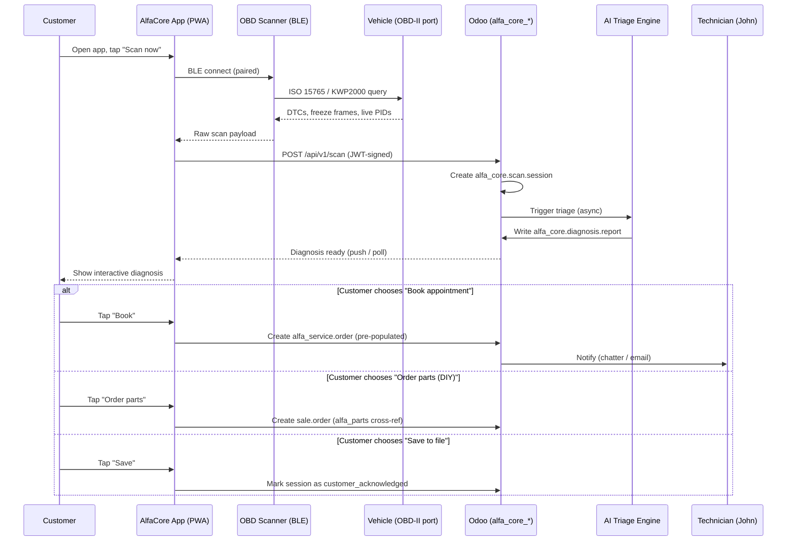
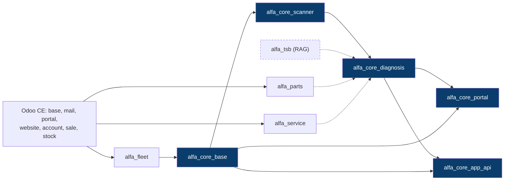
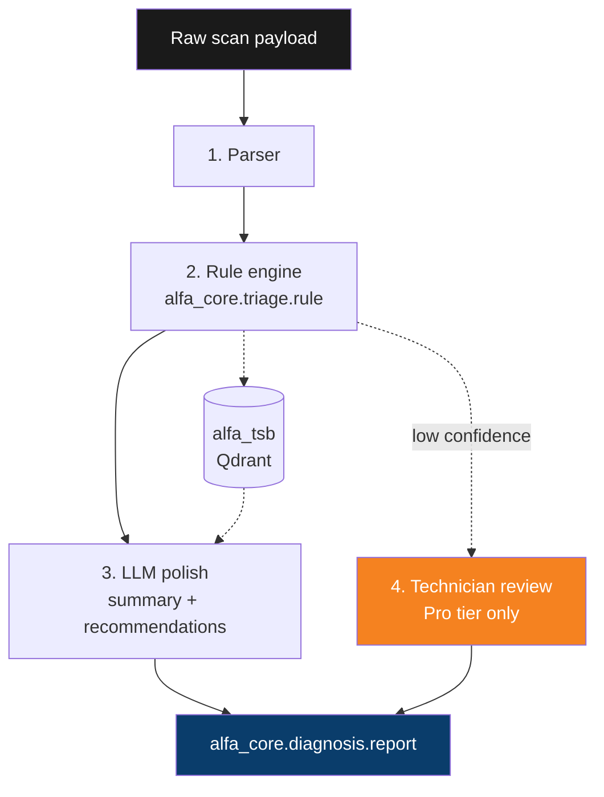
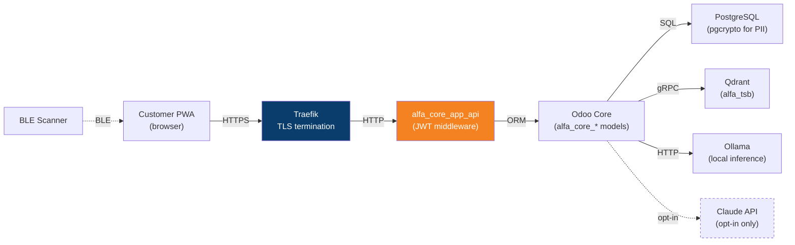
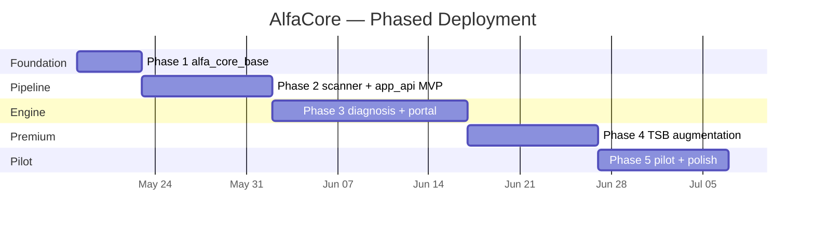

# AlfaCore — Customer Diagnostic Service Plan v1.0

**Scope:** Customer-facing diagnostic service for Alfa Romeo / Fiat / Maserati owners. Each customer holds a paired OBD-II scanner, runs scans through a companion application, and receives an interactive diagnosis that attaches to their file in the Alfa Odoo Server. Service is delivered as Odoo modules layered onto the Alfa Odoo Server Plan v1.0 base.

**Relationship to Alfa Odoo Server v1.0:** AlfaCore is **not** a replacement. The v1.0 plan defined an internal sandbox keyed to John's personal vehicles. AlfaCore is the **customer engagement layer** that converts that sandbox into a multi-tenant service offering — same substrate, same module foundation, but with PIPEDA reintroduced and the operator–customer boundary made explicit.

**Substrate:** Same as v1.0 — QNAP H1277AXU-RP, Docker Compose stack, Traefik reverse proxy, Coolify lifecycle. Public subdomain promoted to `app.alfacore.ca` (or `core.odooiq.com/alfa`) once PIPEDA controls land. Mobile companion app served as PWA from same host or distributed via TestFlight / Play Console internal track during pilot.

**Audience:** John D'Angelo as service operator and lead technician; pilot customers drawn from the existing Toronto Alfa Romeo / Fiat / Maserati owner community.

**Posture:** Same engineering discipline as `luxury_painter`, `event_extend`, and the v1.0 plan — audit trail from day one, named limits, configuration-as-data, idempotent intermediates, honest boundaries between what AlfaCore diagnoses and what still needs a human technician. The transition from sandbox to customer service raises the compliance bar; it does not raise the engineering bar.

**Status:** Draft v1.0. Pending: hardware vendor selection (Vgate iCar Pro BLE 4.0 vs OBDLink MX+ vs branded reference unit), pilot cohort sizing, subscription pricing, and AI inference disposition (Ollama-local vs Claude API tier per customer).

---

## 1. The Pivot — What AlfaCore Changes

### 1.1 v1.0 was a sandbox. AlfaCore is a service.

The Alfa Odoo Server Plan v1.0 was explicit about its boundaries: single-operator, no PIPEDA, internal sandbox. AlfaCore inverts every one of those constraints. The same `alfa_fleet`, `alfa_parts`, `alfa_service`, `alfa_tsb` foundation is preserved, but on top of it AlfaCore introduces:

| Dimension | v1.0 (Sandbox) | AlfaCore (Service) |
|---|---|---|
| **Users** | John only | John + customers (each a `res.partner` with a portal account) |
| **Vehicles** | John's Stelvio + future Italian fleet | Customer-owned vehicles, multi-tenant via VIN scoping |
| **PIPEDA / privacy** | Excluded — no third-party data | **Reintroduced** — customer PII, vehicle data, diagnostic history |
| **Authentication** | Single admin login | Portal users, JWT-signed app sessions, scanner pairing tokens |
| **Hardware** | None | OBD-II BLE scanner issued per customer |
| **Workflow trigger** | John manually creates service orders | Customer-initiated scan → automated triage → optional escalation |
| **AI surface** | Optional Ollama TSB retrieval (Phase 4) | **Core feature** — diagnostic triage on every scan |
| **Revenue** | None | Hardware sale + subscription + service escalations + parts orders |

### 1.2 What the customer experiences (one sentence)

> A Toronto-area Alfa Romeo owner pairs a small OBD scanner with the AlfaCore app, presses a button when a warning light comes on, and within ninety seconds sees a plain-English diagnosis attached to their vehicle file — along with three options: book a service appointment, order the parts to DIY, or save it to the file and watch it.

### 1.3 The JTBD the service serves

Independent Italian-platform owners in the GTA are systematically underserved between the extremes of dealer service (expensive, opinionated, eVIN-locked) and generic OBD apps (Torque, Carista, FORscan) that don't understand FCA proprietary codes, Multi-Air actuation, AFLS calibration, or the DA10/DA11/MZ2 fluid distinctions a real Alfa specialist treats as table stakes. AlfaCore occupies that gap: dealer-grade interpretation, independent-shop pricing, customer-owned data, attached to a real specialist (John) when escalation is warranted.

---

## 2. Business Model

### 2.1 Revenue streams

1. **Scanner hardware.** One-time sale or rental of the AlfaCore-paired OBD-II BLE dongle. Branded reference unit if economics support it; otherwise a recommended vendor SKU sold at modest margin.
2. **Subscription tier.** Monthly or annual recurring revenue. Tiers:
   - **AlfaCore Basic** — unlimited generic OBD-II scans, basic DTC dictionary, scan history. No AI interpretation, no Alfa-specific knowledge base.
   - **AlfaCore Premium** — adds full FCA/Stellantis proprietary code coverage, AI-generated plain-English triage, TSB references from the `alfa_tsb` corpus, priority booking.
   - **AlfaCore Pro** — adds direct technician review of escalated scans, video consultation slot, parts pre-quoting, loaner scanner during repairs.
3. **Service escalations.** When a scan triages to "appointment recommended" or "safety critical" and the customer books, AlfaCore captures the service revenue through `alfa_service`. The scan data pre-populates the work order — no diagnostic time billed because the diagnosis is already done.
4. **Parts orders.** When triage recommends DIY, the parts list is one-tap orderable through `alfa_parts`, sourced through Alfa Romeo of Toronto, Maranello, Raceway, or Mopar direct. AlfaCore takes a parts margin.
5. **Premium content / coaching.** DIY video guides keyed to specific DTCs, Maranello-quality service procedures, fluid-spec walkthroughs. The `Alfa Stelvio transfer case fluid compatibility` chat is exactly the shape of premium artifact this should publish.

### 2.2 Unit economics (sketch, pending pilot validation)

- Scanner BOM: $35–60 CAD (Vgate iCar Pro BLE 4.0 or equivalent). Sell at $89–129 or include free with annual subscription.
- Subscription: Basic $9/mo, Premium $24/mo, Pro $59/mo (all CAD).
- Target ratio: 60% Basic / 30% Premium / 10% Pro at maturity.
- Customer acquisition cost: low in Year 1 — pilot cohort from existing dealer/independent network.
- Defensibility comes from the **attached file** — once a customer has 18 months of scan history, fluid changes, service records, and TSB cross-references attached to their VIN inside AlfaCore, switching cost rises sharply.

### 2.3 What this is not

- Not a generic OBD app. Torque Pro and Carista already serve that market.
- Not a roadside assistance service. AlfaCore diagnoses; it does not dispatch tow trucks.
- Not a warranty replacement. AlfaCore does not interface with Stellantis warranty claims.
- Not a multi-brand platform. Italian platform only — Alfa Romeo, Fiat, Maserati. This is a feature, not a limitation. Honest boundaries.

---

## 3. Customer Journey

### 3.1 End-to-end flow



### 3.2 First-time setup (one-time)

1. Customer signs up at `app.alfacore.ca` — creates `res.partner` + portal user.
2. Customer pays subscription + scanner cost via `sale.order` → `account.move`.
3. AlfaCore mails or hands over the scanner. Each scanner has a pre-burned serial and a one-time pairing token printed on the box.
4. Customer opens the app, enters the pairing token, scans the QR code on the back of the dongle. App registers the device against the customer's portal account via the `alfa_core.device` model.
5. Customer enters VIN (or scans the VIN sticker via camera OCR). The VIN is decoded against the `alfa_fleet` lookup table — platform, engine code, transmission code, FAD/Non-FAD, year, trim auto-populate. If the VIN doesn't decode cleanly, the system **fails loud** (Pattern 2: auto-detect over config) — red badge, no silent default — and prompts for manual entry that John reviews before the vehicle is activated.
6. Customer plugs scanner into OBD-II port, ignition to ACC. First scan auto-runs as a baseline.

### 3.3 Recurring usage

- **Warning light triggered.** Customer drives, MIL or other warning illuminates. They open the app, tap "Scan now." Workflow per 3.1.
- **Pre-trip check.** Premium/Pro customers can schedule a weekly baseline scan. Variance from baseline (new pending codes, drift in fuel trim, voltage degradation) generates a proactive notification.
- **Service interval.** AlfaCore tracks mileage from PID 0x31 (distance since codes cleared) and from manual entry. When intervals approach, the app prompts.

---

## 4. System Architecture

### 4.1 Module suite

The AlfaCore service is delivered as five Odoo modules. All depend on the v1.0 `alfa_*` modules and on Odoo CE base modules (`base`, `mail`, `portal`, `website`, `account`, `sale`, `stock`).

| Module | Purpose | Key models |
|---|---|---|
| **`alfa_core_base`** | Customer file extensions, device registry, subscription tracking, account binding | `alfa_core.device`, `alfa_core.subscription`, `alfa_core.subscription.plan`, partner extensions |
| **`alfa_core_scanner`** | OBD scan session ingestion, raw payload parsing, DTC + PID storage, scanner telemetry | `alfa_core.scan.session`, `alfa_core.scan.dtc`, `alfa_core.scan.pid`, `alfa_core.scanner.heartbeat` |
| **`alfa_core_diagnosis`** | DTC library (curated), severity classification, triage engine, AI interpretation | `alfa_core.dtc`, `alfa_core.diagnosis.report`, `alfa_core.diagnosis.recommendation`, `alfa_core.triage.rule` |
| **`alfa_core_portal`** | Customer portal extension — interactive diagnosis UI, scan history, vehicle file view, subscription management | controllers, QWeb templates, OWL components |
| **`alfa_core_app_api`** | REST/JSON API for the companion PWA — JWT auth, device pairing, scan upload, diagnosis polling, action triggers | controllers under `/api/v1/*`, JWT middleware, rate limiting |

### 4.2 Module dependency diagram



Solid arrows are hard dependencies (`__manifest__.py` declares them). Dotted arrows are soft dependencies — the module functions without them but adds capabilities when they are installed.

### 4.3 Why five modules and not one

Five small modules over one big module follows the same discipline as the `luxury_painter` / `event_extend` precedent. Specifically:

- **`alfa_core_scanner` can be reused.** If a future fleet operator wants raw scan ingestion without the customer-facing diagnosis or portal, they install scanner alone.
- **`alfa_core_app_api` is the security surface.** Isolating it as its own module makes the JWT key rotation, rate limiting, and audit boundary obvious. The first thing a PIPEDA auditor asks for is "show me the perimeter" — this module *is* the perimeter.
- **`alfa_core_diagnosis` is the AI surface.** Same argument — isolating where LLM inference happens makes the ZDE decision per customer auditable and configurable.
- **`alfa_core_portal` is theming.** Industrial Futurism design system lives here; the data layer beneath does not know or care about Manrope and Spark Orange.

---

## 5. Data Model

### 5.1 `alfa_core.device` — paired OBD scanner

| Field | Type | Required | Description |
|---|---|---|---|
| `name` | Char | Yes | Display name (e.g., "John's iCar Pro #A047") |
| `serial_number` | Char (unique) | Yes | Hardware serial, indexed |
| `device_model` | Selection | Yes | `vgate_icar_pro_ble_4`, `obdlink_mx_plus`, `alfacore_ref_v1` |
| `firmware_version` | Char | No | Reported by device on connect |
| `pairing_token` | Char | No | One-time token, cleared after pairing |
| `pairing_token_expires` | Datetime | No | Token TTL (24h default) |
| `paired_partner_id` | Many2one(`res.partner`) | No | Current owner |
| `paired_vehicle_id` | Many2one(`alfa_fleet.vehicle`) | No | Currently bound vehicle |
| `paired_date` | Datetime | No | When pairing completed |
| `last_seen` | Datetime | No | Last heartbeat or scan |
| `last_battery_voltage` | Float | No | Last reported battery (V) |
| `state` | Selection | Yes | `manufactured` / `shipped` / `paired` / `active` / `suspended` / `decommissioned` |
| `active` | Boolean | Yes | Standard Odoo active flag |
| `scan_session_ids` | One2many(`alfa_core.scan.session`) | — | All scans from this device |

### 5.2 `alfa_core.subscription`

| Field | Type | Required | Description |
|---|---|---|---|
| `partner_id` | Many2one(`res.partner`) | Yes | Subscriber |
| `plan_id` | Many2one(`alfa_core.subscription.plan`) | Yes | Tier |
| `start_date` | Date | Yes | Activation date |
| `end_date` | Date | No | Renewal date or cancellation date |
| `state` | Selection | Yes | `trial` / `active` / `past_due` / `cancelled` / `expired` |
| `scans_this_period` | Integer | — | Computed, resets on renewal |
| `ai_credits_this_period` | Integer | — | Computed (Premium/Pro only) |
| `sale_order_id` | Many2one(`sale.order`) | No | Originating order |
| `device_ids` | One2many(`alfa_core.device`) | — | Devices on this subscription |

### 5.3 `alfa_core.scan.session`

| Field | Type | Required | Description |
|---|---|---|---|
| `name` | Char (sequence) | Yes | `AC-SCAN-2026-00001` |
| `session_uuid` | Char (unique, indexed) | Yes | Client-generated UUID, used for idempotent upload |
| `device_id` | Many2one(`alfa_core.device`) | Yes | Source scanner |
| `partner_id` | Many2one(`res.partner`) | Yes | Customer (denormalized for query speed) |
| `vehicle_id` | Many2one(`alfa_fleet.vehicle`) | Yes | Scanned vehicle |
| `start_time` | Datetime | Yes | Scan start (client clock) |
| `end_time` | Datetime | Yes | Scan complete (client clock) |
| `received_at` | Datetime | Yes | Server receipt (auth boundary) |
| `mileage_km` | Integer | No | Vehicle odometer at scan |
| `battery_voltage` | Float | No | KL30 voltage at key-on |
| `ambient_temp_c` | Float | No | If reported by ECU |
| `protocol` | Selection | No | `iso_15765_can` / `kwp2000` / `iso_9141` / `j1850_vpw` / `j1850_pwm` |
| `modules_queried` | Char | No | CSV of ECU addresses (`0x7E0,0x7E1,0x747,...`) |
| `modules_responded` | Char | No | Subset that responded |
| `state` | Selection | Yes | `draft` / `running` / `complete` / `failed` / `interpreting` / `interpreted` / `customer_reviewed` / `escalated` / `archived` |
| `raw_payload` | Text | No | Compressed raw OBD response (gzip+base64) — debugging only, GDPR-redactable |
| `dtc_ids` | One2many(`alfa_core.scan.dtc`) | — | DTCs found |
| `pid_ids` | One2many(`alfa_core.scan.pid`) | — | Live PIDs captured |
| `diagnosis_report_id` | Many2one(`alfa_core.diagnosis.report`) | No | Linked triage |
| `customer_action` | Selection | No | `pending` / `booked` / `parts_ordered` / `saved` / `dismissed` |

### 5.4 `alfa_core.scan.dtc` — DTCs found in a session

| Field | Type | Required | Description |
|---|---|---|---|
| `session_id` | Many2one(`alfa_core.scan.session`) | Yes | Parent session |
| `dtc_id` | Many2one(`alfa_core.dtc`) | No | Reference to canonical DTC entry; nullable if unknown code |
| `code_raw` | Char | Yes | Raw code as reported (e.g., `P0301`, `U0073`, `P1AAF`) |
| `module_source` | Char | Yes | Reporting module (e.g., `ECM`, `TCM`, `ABS`, `AFLS`) |
| `status` | Selection | Yes | `pending` / `stored` / `permanent` / `history` |
| `occurrence_count` | Integer | No | If reported by module |
| `freeze_frame_data` | Text | No | JSON dump of freeze frame |
| `first_seen` | Datetime | No | If module reports timestamp |

### 5.5 `alfa_core.dtc` — curated DTC library

| Field | Type | Required | Description |
|---|---|---|---|
| `code` | Char (unique, indexed) | Yes | Canonical code (`P0301`); Pattern 7 canonicalization (case, hyphen-strip) |
| `code_family` | Selection | Yes | `powertrain_generic` / `powertrain_mfg` / `chassis_generic` / `chassis_mfg` / `body_generic` / `body_mfg` / `network_generic` / `network_mfg` |
| `description_short` | Char | Yes | One-line label (system-canonical) |
| `description_long` | Text | Yes | Plain-English explanation |
| `severity` | Selection | Yes | `info` / `advisory` / `warning` / `critical` / `safety` |
| `affected_systems` | Many2many(`alfa_core.system`) | No | Engine, drivetrain, brakes, electrical, comfort, etc. |
| `applicable_platforms` | Many2many(`alfa_fleet.platform`) | No | Giorgio, MQF, EVO, etc. — null = generic |
| `applicable_engines` | Many2many(`alfa_fleet.engine`) | No | GME 2.0T, 2.9 V6, etc. — null = generic |
| `typical_causes` | Text | No | Markdown list of usual root causes |
| `alfa_specific_notes` | Text | No | TSB references, Multi-Air specifics, FAD/Non-FAD distinctions |
| `recommended_action` | Selection | Yes | `monitor` / `diy_possible` / `book_service` / `urgent_service` / `do_not_drive` |
| `estimated_repair_cost_min` | Float | No | CAD |
| `estimated_repair_cost_max` | Float | No | CAD |
| `estimated_repair_labor_hours` | Float | No | At independent specialist rate |
| `parts_suggestion_ids` | Many2many(`alfa_parts.part`) | No | Suggested replacement parts |
| `tsb_reference_ids` | Many2many(`alfa_tsb.bulletin`) | No | Linked TSBs (Phase 4 dependency) |

### 5.6 `alfa_core.diagnosis.report` — AI triage output

| Field | Type | Required | Description |
|---|---|---|---|
| `session_id` | Many2one(`alfa_core.scan.session`) | Yes | Source scan |
| `triage_outcome` | Selection | Yes | `clean` / `monitor` / `diy_recommended` / `appointment_recommended` / `urgent` / `safety_critical` |
| `confidence` | Float | Yes | 0.0–1.0, computed from rule coverage and AI agreement |
| `summary_text` | Text | Yes | LLM-generated plain-English summary, audited for hallucinations |
| `summary_source` | Selection | Yes | `rule_only` / `rule_plus_llm` / `llm_with_review` — Pattern 10: honest boundaries |
| `generated_at` | Datetime | Yes | Server time |
| `generation_engine` | Char | Yes | `ollama_llama3.1_8b` / `claude_haiku_4_5` / `claude_opus_4_7` / `rules_only` |
| `inference_zde` | Boolean | Yes | True if no data left the Odoo host during inference |
| `recommendation_ids` | One2many(`alfa_core.diagnosis.recommendation`) | — | Ranked action options |
| `technician_review_state` | Selection | Yes | `not_required` / `pending` / `reviewed` / `corrected` |
| `technician_reviewer_id` | Many2one(`res.users`) | No | Who reviewed (Pro tier escalation) |
| `technician_notes` | Text | No | Override or annotation |
| `customer_acknowledged` | Boolean | No | Customer opened the diagnosis in app |
| `customer_acknowledged_at` | Datetime | No | When |

### 5.7 `alfa_core.diagnosis.recommendation` — ranked actions

| Field | Type | Required | Description |
|---|---|---|---|
| `report_id` | Many2one(`alfa_core.diagnosis.report`) | Yes | Parent |
| `action_type` | Selection | Yes | `book_service` / `order_parts` / `diy_guide` / `monitor` / `clear_codes` / `escalate_to_technician` |
| `priority` | Integer | Yes | 1 = primary, 2 = alternative, 3 = fallback |
| `label` | Char | Yes | What the customer sees on the button |
| `body` | Text | Yes | The recommendation text shown when expanded |
| `parts_list_ids` | Many2many(`alfa_parts.part`) | No | If `action_type = order_parts` |
| `estimated_cost_min` | Float | No | CAD |
| `estimated_cost_max` | Float | No | CAD |
| `service_template_id` | Many2one(`alfa_service.template`) | No | If `action_type = book_service` |
| `external_url` | Char | No | If `action_type = diy_guide` and content lives outside Odoo |

### 5.8 Partner extensions (in `alfa_core_base`)

`res.partner` gains:

- `alfa_core_customer` (Boolean) — is this partner a service customer?
- `alfa_core_subscription_ids` (One2many)
- `alfa_core_device_ids` (One2many)
- `alfa_core_vehicle_ids` (One2many via `alfa_fleet.vehicle.owner_id`)
- `alfa_core_signup_date` (Datetime)
- `alfa_core_pipeda_consent_date` (Datetime) — explicit opt-in, audit-recorded
- `alfa_core_pipeda_consent_version` (Char) — which consent text version

---

## 6. OBD Scanner Integration

### 6.1 Hardware approach

The scanner does the absolute minimum: it's a passive OBD-II to Bluetooth Low Energy bridge. **All protocol intelligence lives in the companion app.** This is deliberate.

- **Why thin scanners.** Smart scanners (Autel, Launch, wiTECH-compatible clones) cost $300–2000 and are firmware-locked. Thin BLE scanners cost $30–60, are commodity, and updateable through the app. The intelligence belongs in software you control, not firmware you don't.
- **Recommended baseline:** Vgate iCar Pro BLE 4.0. Cheap, reliable, BLE 4.0 (works with iOS Web Bluetooth restrictions), supports CAN/KWP2000/ISO 9141 / J1850. Known clone risk — buy from authorized resellers.
- **Premium baseline:** OBDLink MX+. ~$140, but supports faster CAN throughput, exposes FCA proprietary message classes, and has a documented protocol layer. Worth it for Pro tier customers.
- **Long-term aspiration:** AlfaCore-branded reference unit. Vgate-equivalent BOM, custom enclosure (Industrial Futurism: dark slate aluminum, Spark Orange accent), QR-printed pairing token. Defer until subscription volume justifies the tooling cost (~$8K NRE, 500-unit MOQ).

### 6.2 Protocols supported

| Protocol | Use | Coverage |
|---|---|---|
| **ISO 15765 (CAN)** | All FCA/Stellantis vehicles 2008+ | Primary — all current Giorgio, MQF, EVO platforms |
| **KWP2000 (ISO 14230)** | Older Alfa 159, Brera, GT (2003–2009) | Secondary — pre-CAN OBD-II |
| **ISO 9141-2** | Older Fiat / Lancia | Tertiary — legacy support |
| **J1850 VPW/PWM** | Rare on Italian platform | Not prioritized |

The app auto-detects protocol on first scan and stores it on the vehicle record. Subsequent scans skip auto-detection.

### 6.3 What gets read on a standard scan

| Layer | Data captured | Cost |
|---|---|---|
| **Mode 01 (live data)** | Engine RPM, coolant temp, intake air temp, MAF, MAP, fuel trims (STFT/LTFT), O2 sensor voltages, throttle position, vehicle speed | ~3s |
| **Mode 02 (freeze frame)** | Snapshot of Mode 01 at the moment a DTC was set | ~1s per DTC |
| **Mode 03 (stored DTCs)** | All confirmed DTCs from all responding ECUs | ~2s per module |
| **Mode 07 (pending DTCs)** | DTCs that haven't completed the two-trip drive cycle yet | ~2s per module |
| **Mode 09 (vehicle info)** | VIN, calibration ID, CVN | ~1s |
| **Mode 0A (permanent DTCs)** | Federally mandated, cannot be cleared except by repair completion | ~1s per module |
| **FCA proprietary (Premium)** | Multi-Air actuator status, AFLS proxy alignment, transfer case mode, dual-clutch adaptation values | Variable |

A complete Basic scan finishes in 20–45s. A complete Premium scan including FCA proprietary modules finishes in 60–120s.

### 6.4 What the app explicitly does **not** do

Honest boundaries (Pattern 10). The companion app does not:

- **Clear DTCs.** Clearing codes is a service action, not a diagnostic action. Customers who want codes cleared get walked through it manually after acknowledging that doing so resets the emissions readiness monitors and may invalidate inspection eligibility for two drive cycles.
- **Write to ECU memory.** No coding, no calibration, no key programming, no immobilizer touching. Anything that writes is technician-only.
- **Run actuator tests.** Bidirectional control (cycling the fuel pump, commanding the EVAP solenoid, triggering AFLS sweep) is technician-only.
- **Bypass safety interlocks.** No "force regen" on diesel particulate filters. No transmission service mode without physical service access.

These limits are named in the UI explicitly. The Premium / Pro tier doesn't unlock these capabilities — escalation to a technician unlocks them. This protects the customer, John's liability exposure, and the integrity of the diagnostic record.

---

## 7. Companion Application

### 7.1 Why PWA, not native

Progressive Web App (PWA) targeting iOS Safari and Android Chrome via Web Bluetooth API. Reasons:

- **Single codebase.** One TypeScript + OWL 2 codebase serves iOS and Android. Same OWL convention as `luxury_painter`'s configurator — keeps the front-end stack consistent.
- **Web Bluetooth API now stable.** Chrome on Android, Safari on iOS (with caveats), and all desktop browsers expose Bluetooth GATT services to web code. The Vgate iCar Pro and OBDLink dongles expose standard SPP-over-BLE that Web Bluetooth can speak.
- **No app store gatekeeping.** Critical for the pilot phase. PWA installs via "Add to Home Screen" — no Apple review, no Google Play approval, no $99/year developer fee gating MVP.
- **Same-origin model.** The PWA is served from `app.alfacore.ca` — same TLS cert as the Odoo host, same JWT, no CORS gymnastics.

If a future feature genuinely requires native (e.g., background BLE scanning while screen is off, Apple CarPlay integration), wrap the PWA in Capacitor and ship to TestFlight / Play Console. Don't pay that cost speculatively.

### 7.2 App screens (MVP)

| Screen | Function |
|---|---|
| **Onboarding** | Account creation, PIPEDA consent, subscription selection, payment, scanner pairing |
| **Home** | Vehicle status card, "Scan now" button, last scan summary, subscription tier indicator |
| **Scan in progress** | Animated indicator, module-by-module progress (ECM responded, TCM responded, ABS pending...), cancel button |
| **Diagnosis result** | Triage banner (color-coded by severity), summary text, three action buttons (priority 1–3 from `recommendation_ids`), "View full report" expand, "Save to file" / "Acknowledge" |
| **Vehicle file** | Read-only view of the customer's `alfa_fleet.vehicle` record — VIN, platform, engine, mileage trend, service history (from `alfa_service`), parts purchased, all linked scans |
| **Scan history** | List of all `alfa_core.scan.session` for this customer, filterable by vehicle, by severity, by date |
| **Settings** | Subscription management, payment method, scanner management (pair another, decommission), notification preferences, PIPEDA data export, account deletion |

### 7.3 PWA design system

Industrial Futurism, ported from the OdooIQ website but tightened for mobile:

- Primary: **Industrial Blue** `#0A3D6B` for chrome and navigation.
- Accent: **Spark Orange** `#F58220` for the primary call-to-action (the "Scan now" button, primary recommendations).
- Secondary accent: **Electric Cyan** `#00B4D8` for informational badges, links, secondary buttons.
- Surface: **Dark Metal** `#1A1A1A` background, `#222` cards, white text.
- Severity color overrides (semantic, not aesthetic):
  - `clean` / `monitor`: Electric Cyan
  - `diy_recommended`: Spark Orange
  - `appointment_recommended`: amber `#FFB020`
  - `urgent`: orange-red `#FF5500`
  - `safety_critical`: red `#D32F2F`
- Typography: **Manrope** for body, **Space Mono** for codes (DTC codes, VIN, mileage) — keeps the same hierarchy as ANDREW v2 and the OdooIQ site.

### 7.4 API contracts (alfa_core_app_api)

All endpoints under `/api/v1/`. All require `Authorization: Bearer <JWT>` except `/api/v1/auth/*`. JWT signed with HS256, 24h expiry, refresh via `/api/v1/auth/refresh`.

| Endpoint | Method | Purpose |
|---|---|---|
| `/auth/login` | POST | Email + password → JWT |
| `/auth/refresh` | POST | Refresh token → new JWT |
| `/auth/logout` | POST | Invalidate token |
| `/device/pair` | POST | Pairing token + serial → bind device to current partner |
| `/device/heartbeat` | POST | Scanner check-in (battery, firmware, last_seen) |
| `/vehicle/list` | GET | All vehicles owned by current partner |
| `/vehicle/<id>/file` | GET | Full vehicle file — fleet record + service history + scan history |
| `/scan/upload` | POST | Upload a complete scan session (raw payload + parsed DTCs + PIDs) — idempotent by `session_uuid` |
| `/scan/<id>/status` | GET | Poll for diagnosis readiness |
| `/scan/<id>/diagnosis` | GET | Fetch `alfa_core.diagnosis.report` JSON |
| `/scan/<id>/action` | POST | Submit customer choice (`book_service` / `order_parts` / `saved` / `dismissed`) |
| `/subscription/current` | GET | Active subscription detail |
| `/dtc/lookup/<code>` | GET | Curated DTC entry (rate-limited; cached aggressively) |
| `/pipeda/export` | POST | Customer requests full data export (PIPEDA right of access) |
| `/pipeda/delete` | POST | Customer requests account deletion (PIPEDA right of erasure) |

Rate limiting: 60 req/min per JWT for most endpoints, 10/min for `/scan/upload`, 2/min for `/pipeda/*`. Implemented via `ir.http` middleware backed by Redis.

---

## 8. Diagnosis Engine

### 8.1 Three-layer triage

The diagnosis engine is layered so that each layer's contribution to the final report is auditable.



**Layer 1 — Parser.** Pure deterministic. Converts raw OBD response bytes into structured `alfa_core.scan.dtc` and `alfa_core.scan.pid` rows. No interpretation. Pattern 5: idempotent — same input always produces same output, no LLM in this layer.

**Layer 2 — Rule engine.** A library of `alfa_core.triage.rule` records, each scoped by platform / engine / DTC pattern, that produce a structured triage outcome and a candidate recommendation set. Rules are data, not code (Pattern 6). Example rule:

```
IF dtc.code IN ('P0301','P0302','P0303','P0304')
AND vehicle.engine = 'GME 2.0T'
AND vehicle.mileage_km > 100000
THEN triage_outcome = 'diy_recommended'
     summary_template = 'misfire_coil_pack_aging'
     primary_recommendation = order_parts(['coil_pack_GME_2_0T', 'spark_plug_NGK_ILZKAR8H8S'])
     estimated_cost_range = (180, 340)
     confidence = 0.78
```

Confidence is computed from the proportion of the DTC set covered by a single rule. If multiple rules match orthogonally (engine codes + chassis codes), confidence drops and the triage outcome biases toward the more severe rule.

**Layer 3 — LLM polish.** The structured rule output is fed into an LLM prompt that produces the customer-facing `summary_text` — plain English, contextual, with the customer's name and vehicle. The LLM is constrained to a JSON schema and **never** allowed to override the triage outcome or recommendations from Layer 2. It only writes prose. This is Pattern 10 (honest boundaries) — the LLM's job is rhetoric, not diagnosis.

**Layer 4 — Technician review.** Pro tier customers have every diagnosis routed through John's review queue before being released. Basic and Premium customers get instant release; their reports carry `summary_source = rule_only` or `rule_plus_llm`, never `llm_with_review`.

### 8.2 Inference disposition (the ZDE decision)

The `inference_zde` flag on every `alfa_core.diagnosis.report` records whether scan data left the Odoo host during inference. The policy is per-subscription-tier and per-customer-override:

| Tier | Default inference | Customer can override? |
|---|---|---|
| Basic | Rules only — no LLM, no third party. `inference_zde = True` always | N/A — there is no LLM |
| Premium | Ollama-local (Llama 3.1 8B Instruct or equivalent) on the same Coolify host. `inference_zde = True` | Customer can opt-in to Claude Haiku 4.5 for higher-quality prose — `inference_zde` flips to False, consent logged |
| Pro | Same as Premium + technician review | Same opt-in available |

This makes the privacy disposition explicit and recorded on every report. A PIPEDA audit can answer "which customers had their data leave this host" in a single query.

### 8.3 The DTC library — seed strategy

The `alfa_core.dtc` table is the curated knowledge base. It is the durable asset of the business. Seeding it:

1. **Generic OBD-II codes (~5000)** — from public sources (SAE J2012). Bulk import in Phase 1.
2. **FCA/Stellantis proprietary codes (~1500 relevant to Italian platform)** — curated from John's dealer experience, supplemented by TSBs and public Stellantis service literature. This is the moat — generic OBD apps don't have this. Phase 2.
3. **Curated severity, causes, cost ranges** — written by John, one DTC at a time. This is the slow work. Start with the top 100 DTCs by expected frequency for Giorgio platform 2017–2025 (misfires, coil packs, EVAP system, throttle body, AFLS, transfer case, Multi-Air solenoids). Expand from there.
4. **Auto-link to TSBs** — once `alfa_tsb` is ingested (v1.0 Phase 4), cross-reference DTCs to TSBs via the Qdrant `alfa_tsb` collection.

The library is **versioned**. Each `alfa_core.dtc` record has a `revision` integer and a `revised_by_id` / `revised_at`. The `Alfa Stelvio transfer case fluid compatibility` chat is exactly the shape of artifact that should land as a curated DTC entry annotation or a service procedure linked from the relevant transfer-case-related codes.

---

## 9. Customer File Integration

### 9.1 The "attached to file" requirement, decomposed

When you said _"application that is attached to each customer's file,"_ that's three integration points:

1. **Every scan attaches to the vehicle.** `alfa_core.scan.session.vehicle_id` is required. The vehicle record's chatter shows a one-line entry for every scan with severity badge.
2. **Every diagnosis attaches to the customer.** `alfa_core.diagnosis.report` is reachable via `partner_id.alfa_core_subscription_ids.scan_session_ids` and shows up in the partner's portal view.
3. **Every action attaches to the service record.** A "book service" action creates an `alfa_service.order` with the scan and diagnosis linked. A "order parts" action creates a `sale.order` with the diagnosis linked via a custom field `sale.order.alfa_core_diagnosis_id`. The diagnostic provenance is preserved through the entire downstream business workflow.

### 9.2 The vehicle file becomes a longitudinal record

Over 18 months of subscription, a customer's vehicle file accumulates:

- Every scan (10–50+)
- Every diagnosis (one per scan with codes)
- Every parts order with diagnostic provenance
- Every service appointment with diagnostic provenance
- Every fluid change, every TSB checked, every mileage point logged
- Every photo the technician took during service (via `alfa_service` attachment workflow)

This is the defensible asset. A customer who has built this record on AlfaCore for 18 months and then considers switching to a generic OBD app or going back to dealer service is leaving an artifact behind that they cannot reconstruct. PIPEDA gives them the right to export it — and the export is honest, complete, machine-readable JSON + PDF — but the daily utility of the longitudinal record is the lock-in.

### 9.3 PIPEDA export contract

`POST /api/v1/pipeda/export` returns a signed URL to a downloadable archive containing:

- `partner.json` — full `res.partner` record
- `subscriptions.json` — full subscription history
- `vehicles/<vin>/vehicle.json` — fleet record
- `vehicles/<vin>/scans/<session_uuid>.json` — every scan with raw payload, DTCs, PIDs
- `vehicles/<vin>/diagnoses/<session_uuid>.json` — every report
- `vehicles/<vin>/service_orders.json` — every service appointment
- `vehicles/<vin>/sale_orders.json` — every parts order
- `vehicles/<vin>/history.pdf` — human-readable longitudinal record, QWeb-rendered, Industrial Futurism-styled

Generated asynchronously, customer notified via email when ready. Same shape as the v1.0 phased deployment plan's QWeb service history report — but customer-scoped and PIPEDA-compliant.

---

## 10. Security & PIPEDA

### 10.1 What changes from v1.0

The v1.0 sandbox said "No PIPEDA / TD / Marriott regime — internal use only." AlfaCore deletes that line. Specifically:

- **Customer PII** — name, email, phone, address, payment method tokens — is now stored.
- **Vehicle identity** — VIN — is personal information under PIPEDA when associated with a named individual.
- **Diagnostic data** — DTCs, mileage, driving patterns from PIDs — is personal information.
- **Behavioral data** — scan frequency, time-of-day patterns, location-from-IP — is personal information.

### 10.2 PIPEDA controls (mandatory)

| Principle | Implementation |
|---|---|
| **Accountability** | Named privacy officer (John initially). Documented privacy policy at `/privacy`. |
| **Identifying purposes** | Onboarding consent screen names every data category and what it's used for. |
| **Consent** | Explicit, granular, versioned. `alfa_core_pipeda_consent_version` on partner record. Consent can be withdrawn per-category without canceling subscription (but withdrawing diagnostic-data consent disables the diagnostic feature — honestly named). |
| **Limiting collection** | Raw OBD payload retained 90 days, then purged. Parsed DTCs and PIDs retained for subscription lifetime + 7 years (warranty-relevant). |
| **Limiting use, disclosure, retention** | No third-party sharing without explicit opt-in. AI inference disposition (§8.2) is the surface-level expression of this. |
| **Accuracy** | Customer can correct any vehicle / partner field via portal. Diagnostic reports are immutable but can be technician-annotated. |
| **Safeguards** | TLS 1.3, JWT with rotation, encrypted at rest (PostgreSQL pgcrypto for sensitive columns), filesystem-level encryption on QNAP via `zfs` native encryption. |
| **Openness** | Privacy policy public. PIPEDA contact published. |
| **Individual access** | `POST /api/v1/pipeda/export` (§9.3) |
| **Challenging compliance** | Published email for PIPEDA inquiries, response SLA documented. |

### 10.3 Security perimeter



The auth boundary is `alfa_core_app_api`. Everything inbound from customer devices crosses it. Everything outbound to Claude (the only third-party hop) is explicitly consented and per-record flagged.

### 10.4 What this is not

AlfaCore is not SOC 2 audited at launch. It is PIPEDA-compliant by design. SOC 2 becomes relevant when a B2B customer (a fleet operator, a specialty insurer, a leasing company) asks for it. At consumer scale, PIPEDA is the operative regime and SOC 2 is overreach — honest boundaries.

---

## 11. Phased Deployment

Five phases over ~10 weeks if all phases run sequentially. Phases 1–3 are mandatory for MVP; Phase 4 is opt-in but recommended; Phase 5 is post-pilot.

### Phase 1 — Foundation (`alfa_core_base`) — 1 week

- Build `alfa_core.device`, `alfa_core.subscription`, `alfa_core.subscription.plan`.
- Extend `res.partner` with the `alfa_core_*` fields.
- Seed three subscription plans (Basic / Premium / Pro) as data.
- Build portal account binding wizard (existing portal user → subscription).
- Build PIPEDA consent screen as a portal controller.
- **Exit criteria:** John can create a test customer, activate a Basic subscription, and see the customer's portal home page with no scanner paired.

### Phase 2 — Scanner pipeline (`alfa_core_scanner` + `alfa_core_app_api` MVP) — 2 weeks

- Build `alfa_core.scan.session`, `alfa_core.scan.dtc`, `alfa_core.scan.pid`.
- Build `/api/v1/auth/*`, `/api/v1/device/pair`, `/api/v1/scan/upload`.
- Build a minimal PWA scaffold (TypeScript + OWL 2): login, pairing flow, scan trigger via Web Bluetooth, upload.
- Implement OBD parser library (Mode 01/03/07/09/0A first; Mode 02 next).
- **Exit criteria:** John can pair a real Vgate dongle to a test account, plug into the Stelvio, run a scan, see the session appear in Odoo with parsed DTCs.

### Phase 3 — Diagnosis engine (`alfa_core_diagnosis` + `alfa_core_portal`) — 3 weeks

- Build `alfa_core.dtc` library, seed with generic OBD-II + top 100 Alfa-specific entries.
- Build `alfa_core.triage.rule` engine.
- Build `alfa_core.diagnosis.report` + `alfa_core.diagnosis.recommendation`.
- Integrate Ollama for LLM polish (rules → JSON → LLM prompt → prose output).
- Build the customer-facing interactive diagnosis view in the portal and the PWA result screen.
- Wire action buttons: "book service" creates `alfa_service.order`, "order parts" creates `sale.order`.
- **Exit criteria:** A scan on John's Stelvio that produces a real DTC (e.g., a deliberately introduced gas cap fault for P0457) generates an interactive diagnosis the customer can step through end-to-end, including ordering the replacement part.

### Phase 4 — TSB-augmented diagnosis (Premium feature) — 2 weeks

- Depends on v1.0 Phase 4 (`alfa_tsb` RAG ingestion).
- Augment the LLM prompt with retrieved TSBs.
- Surface TSB references in the diagnosis report (`alfa_core.dtc.tsb_reference_ids` becomes a live join into Qdrant results, not a static list).
- **Exit criteria:** A scan that hits a TSB-documented condition (e.g., a P200A intake manifold runner DTC on a Stelvio 2.0T) surfaces the relevant TSB in the diagnosis text.

### Phase 5 — Pilot and post-pilot polish — 2 weeks

- Recruit 5–10 pilot customers from Toronto Alfa Romeo / Fiat / Maserati owner community.
- Branded scanner unboxing kit (printed pairing card, QR code, Industrial Futurism packaging).
- Pro-tier technician review queue inbox.
- Monitoring dashboard: scan volume by customer, diagnosis confidence distribution, escalation rate, parts-order conversion rate, subscription churn.
- **Exit criteria:** Pilot cohort runs for 30 days with 90%+ scan success rate, NPS ≥ 8, ≥ 2 service escalations converted, ≥ 5 parts orders converted, zero PIPEDA incidents.

### 11.1 Phase Gantt



Total: ~10 weeks for a complete pilot-ready service. ~6 weeks to functional MVP if Phase 4 is deferred to post-pilot.

---

## 12. Alignment with the Twelve Patterns

Same doctrine as ANDREW v2 Part X, v1.0 Plan, `luxury_painter`, `event_extend`.

| Pattern | Application in AlfaCore |
|---|---|
| **1. Finite pipeline stages with observability** | Scan session lifecycle: `draft → running → complete → interpreting → interpreted → customer_reviewed → escalated`. Each transition logged with timestamp and trigger source. |
| **2. Auto-detect over config, fail loud** | VIN decoding, protocol detection, scanner model detection. Mismatch fails loud with a red banner, never silently defaults to "generic Alfa". |
| **3. Anchor-text extraction (labels=API)** | Field labels and API names agree. The PWA UI says "Stored DTCs" and the API returns `status: "stored"` — no translation layer. |
| **4. Per-fund isolation → per-VIN isolation** | Every diagnostic record is VIN-scoped. No cross-customer or cross-vehicle data smearing. A multi-vehicle customer sees three separate files, not one merged record. |
| **5. Idempotent timestamped intermediates** | `session_uuid` makes scan upload retry-safe. Raw payload archived with timestamp before parsing. Re-parsing produces the same `alfa_core.scan.dtc` rows. |
| **6. StatementConfig → TriageRule as data** | Shallow vehicle differences (Stelvio vs Giulia, FAD vs Non-FAD, RWD vs Q4, GME 2.0 vs 2.9 V6) drive triage outcomes via data, not via if/else. New rules ship as data migrations, no code redeploy. |
| **7. canon_label** | DTC codes canonicalized: `P0301`, `p0301`, `P-0301`, `P 0301` all resolve to the same `alfa_core.dtc` record. Same for part numbers, fluid specs, VINs (whitespace, hyphens, case). |
| **8. Information budgets per stage** | Scan upload limit 256 KB. Diagnosis report ≤ 4 KB summary. PWA push notification ≤ 200 chars. PIPEDA export streamed, not loaded into memory. |
| **9. Logging as UI** | The scan-in-progress screen *is* the log. Each module response is rendered to the user as it arrives. Same posture as the ANDREW pipeline status. |
| **10. Honest boundaries** | The app does not clear codes, write to ECU, run actuator tests, or bypass safety interlocks (§6.4). Named, not silent. The LLM does not override rule-engine triage outcomes (§8.1). |
| **11. (per ANDREW v2 Part X)** | Per-record privacy disposition (`inference_zde` flag) — same posture as the SFP flag in ANDREW: tell the truth about what was done. |
| **12. (per ANDREW v2 Part X)** | DTC library versioned, every revision auditable. Same posture as the StatementConfig revision history. |

---

## 13. Open Decisions

These are the calls that determine downstream architecture and that I don't have enough context to make alone.

1. **Scanner hardware vendor.** Vgate iCar Pro BLE 4.0 (cheap, commodity, clone risk) vs OBDLink MX+ (premium, documented, $140) vs branded reference unit (defer until volume). My recommendation: Vgate for Basic/Premium tiers, OBDLink MX+ included with Pro tier. Decision needed before Phase 2.
2. **Pricing.** The Basic $9 / Premium $24 / Pro $59 numbers are sketches. Real numbers depend on inference cost per scan (Ollama is free at the host level but consumes RAM; Claude Haiku is ~$0.001 per diagnosis at current pricing), expected scan volume per customer per month, and competitive positioning vs Carista Pro ($60/year) and dealer diagnostic-only visits ($150+ per visit).
3. **Inference disposition default.** Should Premium default to Ollama-local with Claude opt-in (my recommendation, ZDE-first), or default to Claude with Ollama opt-in (better prose quality, more cost, ZDE-second)? Decision affects Phase 3 architecture.
4. **Pilot cohort source.** Through existing Toronto dealer network contacts (Alfa Romeo of Toronto, Maranello), through OdooIQ contact list, through Alfa Romeo Owners Club of Canada, or through a small paid ad campaign? Affects Phase 5 timing.
5. **Pro tier technician review SLA.** What's the realistic turnaround? 4 hours business hours? Next business day? Affects Pro pricing.
6. **Maserati / Fiat scope at launch.** v1.0 Plan made Italian platform first-class. Should AlfaCore launch supporting all three brands, or launch Alfa-only and add Fiat/Maserati in Phase 6? Affects DTC library seeding effort.
7. **Brand naming.** "AlfaCore" — is this final? It implies Alfa-centricity, which conflicts with full Italian-platform scope. Alternatives: "TifosiCore", "MeccanicaCore", "IT Platform Diagnostics" (boring but accurate). Brand decision before any customer-facing surface.
8. **Substrate promotion.** The v1.0 Plan ran on QNAP via Traefik + Coolify, no public exposure. Customer-facing AlfaCore needs public TLS. Stay on QNAP with Tailscale Funnel exposing the public surface, or promote to Hetzner / Vultr cloud VM with the QNAP as cold backup? Affects Phase 1 substrate work.

---

## 14. Manifest Skeletons

For Forgejo scaffolding. Once decisions §13.1–§13.3 land, these can be generated and committed.

### `alfa_core_base/__manifest__.py`

```python
{
    "name": "AlfaCore — Customer Service Base",
    "version": "19.0.1.0.0",
    "category": "Services/AlfaCore",
    "summary": "Customer file, device registry, subscription for AlfaCore diagnostic service",
    "author": "REAL Partners Ltd. / OdooIQ",
    "website": "https://odooiq.com",
    "license": "LGPL-3",
    "depends": [
        "base",
        "mail",
        "portal",
        "account",
        "sale",
        "alfa_fleet",
    ],
    "data": [
        "security/alfa_core_security.xml",
        "security/ir.model.access.csv",
        "data/alfa_core_subscription_plan_data.xml",
        "data/alfa_core_pipeda_consent_data.xml",
        "views/alfa_core_device_views.xml",
        "views/alfa_core_subscription_views.xml",
        "views/res_partner_views.xml",
        "views/alfa_core_menus.xml",
    ],
    "installable": True,
    "application": False,
}
```

### `alfa_core_scanner/__manifest__.py`

```python
{
    "name": "AlfaCore — Scanner Ingestion",
    "version": "19.0.1.0.0",
    "category": "Services/AlfaCore",
    "summary": "OBD scan session ingestion, DTC and PID storage",
    "depends": ["alfa_core_base", "alfa_fleet"],
    "data": [
        "security/ir.model.access.csv",
        "views/alfa_core_scan_session_views.xml",
        "views/alfa_core_scan_dtc_views.xml",
        "views/alfa_core_scan_pid_views.xml",
    ],
    "installable": True,
}
```

### `alfa_core_diagnosis/__manifest__.py`

```python
{
    "name": "AlfaCore — Diagnosis Engine",
    "version": "19.0.1.0.0",
    "category": "Services/AlfaCore",
    "summary": "DTC library, triage rules, AI-augmented diagnosis reports",
    "depends": [
        "alfa_core_base",
        "alfa_core_scanner",
        "alfa_parts",
        "alfa_service",
    ],
    "data": [
        "security/ir.model.access.csv",
        "data/alfa_core_dtc_seed_generic.xml",
        "data/alfa_core_dtc_seed_alfa_top100.xml",
        "data/alfa_core_triage_rule_seed.xml",
        "views/alfa_core_dtc_views.xml",
        "views/alfa_core_diagnosis_report_views.xml",
        "views/alfa_core_triage_rule_views.xml",
    ],
    "external_dependencies": {
        "python": ["httpx"],  # for Ollama / Claude API calls
    },
    "installable": True,
}
```

### `alfa_core_app_api/__manifest__.py`

```python
{
    "name": "AlfaCore — Companion App API",
    "version": "19.0.1.0.0",
    "category": "Services/AlfaCore",
    "summary": "JWT-authenticated REST API for the AlfaCore PWA companion application",
    "depends": [
        "alfa_core_base",
        "alfa_core_scanner",
        "alfa_core_diagnosis",
    ],
    "data": [
        "security/ir.model.access.csv",
        "data/ir_config_parameter_data.xml",
    ],
    "external_dependencies": {
        "python": ["pyjwt", "redis"],
    },
    "installable": True,
}
```

### `alfa_core_portal/__manifest__.py`

```python
{
    "name": "AlfaCore — Customer Portal",
    "version": "19.0.1.0.0",
    "category": "Services/AlfaCore",
    "summary": "Customer-facing portal for AlfaCore — interactive diagnosis, scan history, vehicle file",
    "depends": [
        "alfa_core_base",
        "alfa_core_diagnosis",
        "portal",
        "website",
    ],
    "data": [
        "security/ir.model.access.csv",
        "views/portal_templates.xml",
        "views/website_alfacore_templates.xml",
        "views/snippets.xml",
    ],
    "assets": {
        "web.assets_frontend": [
            "alfa_core_portal/static/src/scss/industrial_futurism.scss",
            "alfa_core_portal/static/src/js/diagnosis_interactive.js",
            "alfa_core_portal/static/src/xml/diagnosis_templates.xml",
        ],
    },
    "installable": True,
}
```

---

## 15. What I am explicitly *not* designing in this plan

Honest boundaries (Pattern 10), applied to this document itself.

- **The PWA implementation.** Architecture and screens are specified; the TypeScript + OWL 2 codebase is a separate deliverable.
- **The DTC library content.** Seeding strategy is specified; the 5000+ generic + 1500 Alfa-specific entries are a curation deliverable, not a planning deliverable.
- **The triage rule corpus.** Engine architecture is specified; rules themselves are a curation deliverable, written over time as scan data accumulates.
- **The branded scanner unit.** Vendor-baseline approach is specified; industrial design and tooling are a separate workstream, deferred until subscription volume justifies it.
- **Marketing site.** Pilot recruitment is mentioned; marketing landing page, ad creative, and SEO are a separate Nano Banana / OdooIQ deliverable.
- **Payment processor selection.** Stripe is the obvious default but is not specified — `sale.order` → `account.move` is generic enough that the processor can be swapped later.

---

**End of plan v1.0.**

*Drafted in collaboration with Claude Opus 4.7. Next review: when scanner hardware decision lands and pilot cohort is sized.*
